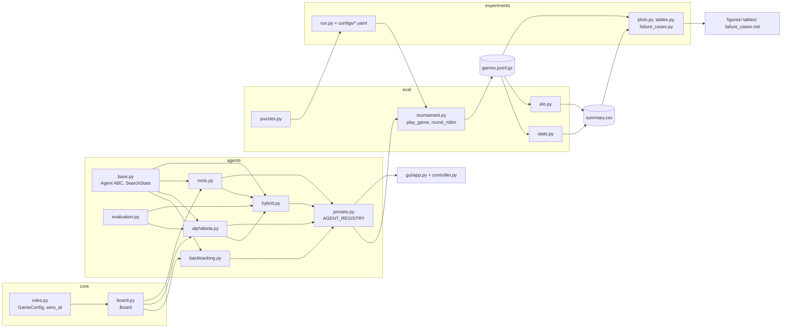
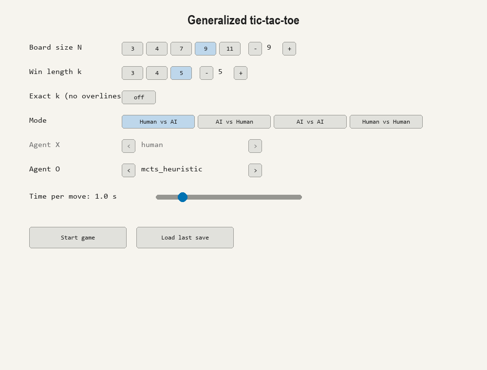
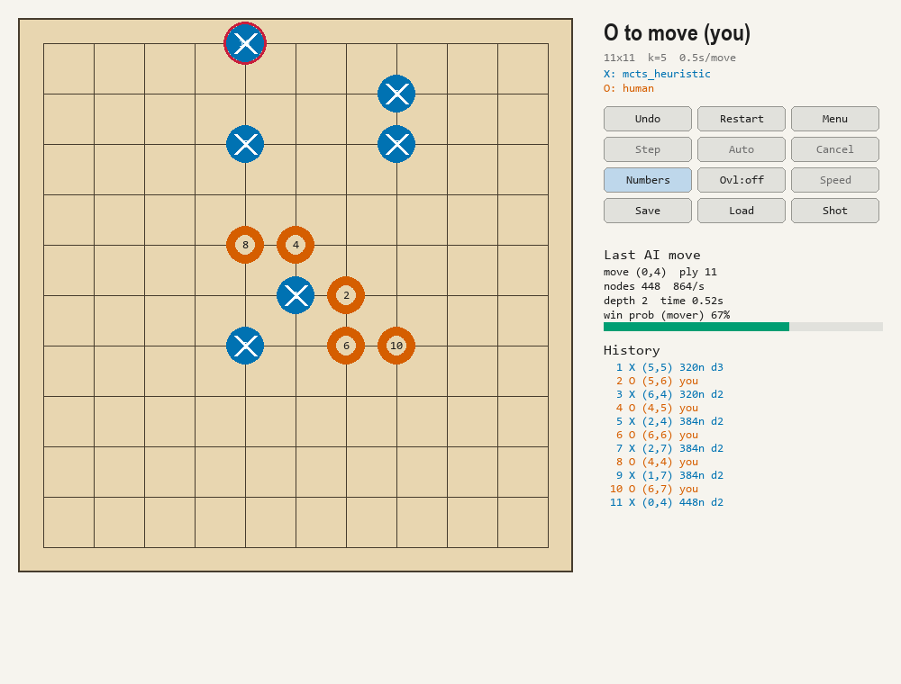
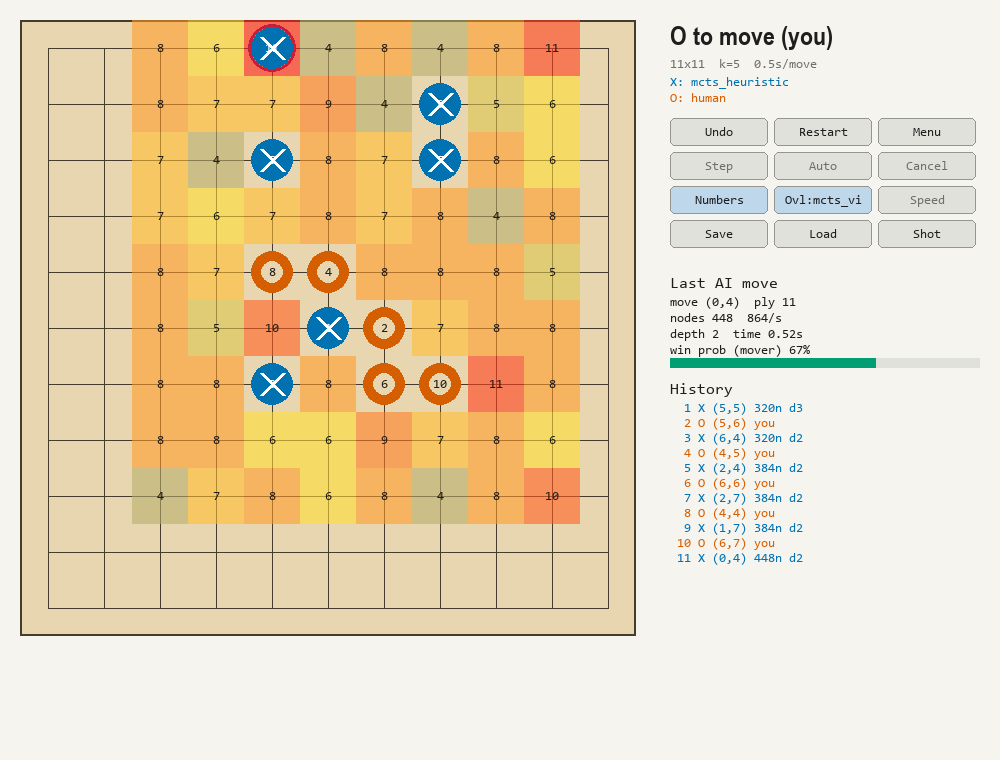
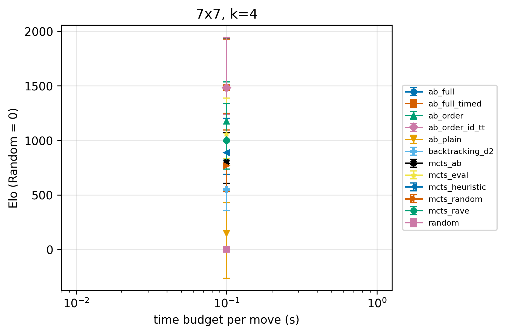
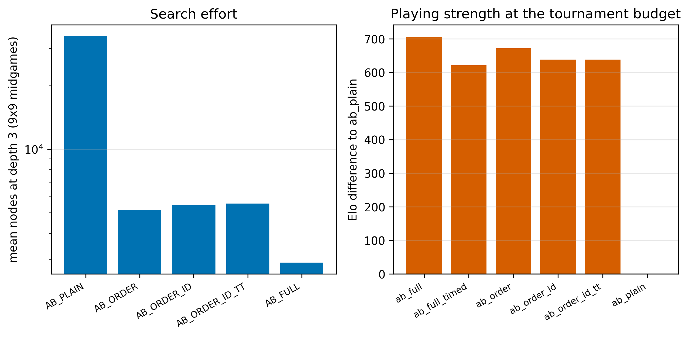
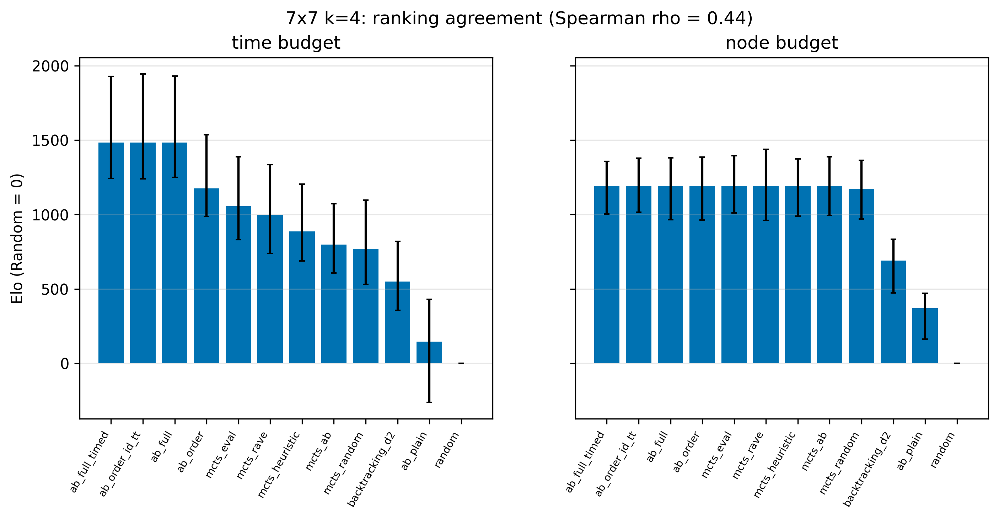
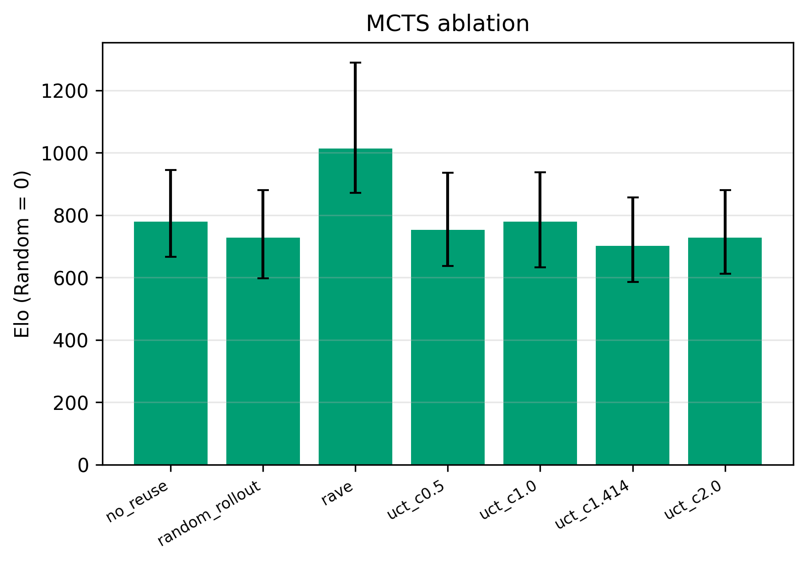
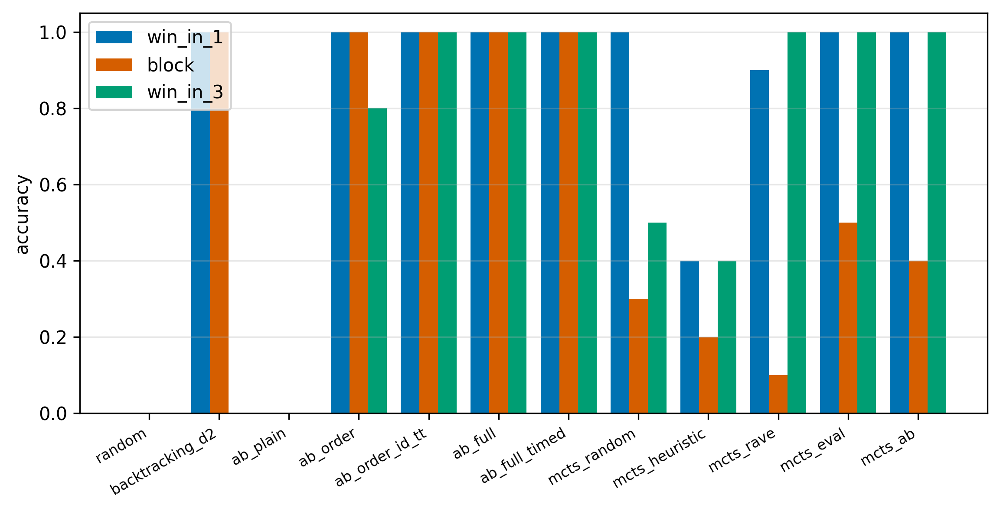

# Generalized Tic-tac-toe (m,n,k-game) AI — CO3061 HW2, Topic 1


-blue)

> Số test lấy từ `python -m pytest --collect-only -q` (259 test, trong đó 35 test đánh dấu `slow`) và lần chạy đầy đủ gần nhất (259 passed).
> Badge là ảnh tĩnh, không tự cập nhật; sửa tay khi số test đổi.

## 1. Giới thiệu

**Đề tài.** Bài tập lớn 2 môn Nhập môn Trí tuệ Nhân tạo (CO3061, HCMUT), Topic 1: tic-tac-toe tổng quát trên bàn $N \times N$ với luật
$k$ quân liên tiếp. Dự án cài đặt **Backtracking (minimax thuần)**, **Alpha-beta pruning** và **MCTS** (cùng các biến thể lai
MCTS–đánh giá tĩnh và MCTS–alpha-beta), một **GUI pygame**, và một **hạ tầng thực nghiệm** so sánh các agent bằng Elo
(Bradley–Terry + bootstrap), khoảng tin cậy Wilson, đổi lượt X/O và opening cân bằng.

**Mục tiêu.** So sánh có kiểm soát ba họ thuật toán trên nhiều kích thước bàn (7×7 k=4, 9×9 k=5, 11×11 k=5) với cùng ngân sách
thời gian (và, để kiểm tra độ bền của kết luận, cùng ngân sách số node). Trọng tâm là *phát biểu bài toán đúng, ablation từng thành phần và so sánh
có khoảng tin cậy*, không phải xây agent mạnh nhất. Các kỹ thuật dùng ở đây (move ordering, iterative deepening, transposition table, RAVE, MCTS–minimax hybrid)
đã được biết trong tài liệu; phần đóng góp của dự án là thiết kế so sánh có kiểm soát và bộ dữ liệu 75.300 ván.

**Tóm tắt 5 phát hiện chính** (chi tiết, CI và nguồn ở mục 12; dữ liệu đã chốt, xem `results/FULL_RUN_SUMMARY.md`):

1. Alpha-beta có move ordering thắng MCTS tốt nhất ở cả ba bàn, khoảng cách Elo tăng theo cỡ bàn: **+97 [+50; +139]** (7×7), **+468 [+414; +516]** (9×9 @0,5 s), **+680 [+595; +832]** (11×11); ở 7×7 đối đầu trực tiếp 0,65 [0,50; 0,78] (40 ván) *chưa phân biệt được*.
2. Trong các thành phần của alpha-beta, chỉ **move ordering** có tác dụng đo được lên sức chơi (`ab_order` vs `ab_plain` = 1,00 [0,96; 1,00], n=100); iterative deepening, transposition table, radius 2 + killer và depth 10 vs 4 *chưa phân biệt được* ở các budget đã thử.
3. Lợi thế của alpha-beta **thu hẹp khi budget tăng** ở 9×9: +468 [+414; +516] (0,5 s) → +332 [+297; +370] (1,0 s).
4. Thứ hạng **không phụ thuộc cách đo budget**: Kendall tau giữa time-budget và node-budget là 0,835 / 0,813 / 0,879 (mức nhiễu nền giữa hai lần chạy cùng cấu hình: 0,933).
5. **Tactical root check (TAC)** giúp MCTS (0,85 [0,71; 0,93] trong ablation; mọi MCTS có TAC giải 30/30 puzzle), còn **RAVE đảo chiều theo bàn**: 0,72 trên 9×9 nhưng 0,325 [0,20; 0,48] trên 7×7.

Kết luận AB > MCTS chỉ áp dụng cho cài đặt Python này (MCTS ≈ 1,1–4,4 nghìn mô phỏng/s (lai AB-leaf chỉ 150–180), `results/bench_mcts.csv`).

## 2. Bắt đầu nhanh

**Yêu cầu:** Python **≥ 3.10** (phát triển trên 3.10.11, Windows 11), `git`. Mọi lệnh chạy từ thư mục gốc của repo.

**Bước 1 — clone:**

```
git clone https://github.com/kaim-tqkhai711/HW2_NMAI_Topic1.git
cd HW2_NMAI_Topic1
```

**Bước 2 — tạo môi trường ảo.**

Windows (PowerShell):

```
python -m venv .venv
.venv\Scripts\Activate.ps1
```

Linux / macOS:

```
python3 -m venv .venv
source .venv/bin/activate
```

**Bước 3 — cài thư viện** (`requirements.txt` ghim đúng phiên bản đã dùng cho kết quả báo cáo: numpy 1.26.4, PyYAML 6.0.3, matplotlib 3.10.9, pygame 2.6.1, psutil 7.2.2, pytest 8.2.2, mypy 2.4.0):

```
pip install -r requirements.txt
```

**Bước 4 — chạy GUI:**

```
python -m gui.app
```

**Bước 5 — chạy test nhanh** (224 test, bỏ test `slow`; khoảng 2–3 phút):

```
python -m pytest -q -m "not slow"
```

Các lệnh khác: toàn bộ test `python -m pytest -q` (259 test, khoảng 7–10 phút), kiểm tra kiểu `python -m mypy` (cấu hình `strict = true` trên `core/` và `agents/` trong `pyproject.toml`),
smoke test GUI không cần màn hình `python -m gui.app --headless-check`. Chi tiết ở mục 10 và 11.

> Trên Linux không có màn hình, đặt `SDL_VIDEODRIVER=dummy` trước khi chạy `--headless-check` hoặc test GUI (`tests/test_gui_app.py` tự đặt biến này).

## 3. Luật chơi và phát biểu bài toán

### 3.1 Luật

* Bàn $N \times N$, ô nhận giá trị `EMPTY = 0`, `X = 1`, `O = -1` (`core/rules.py`). **X đi trước**, hai bên luân phiên.
* **Thắng:** $k$ quân liên tiếp của cùng một bên theo hàng, cột hoặc một trong hai đường chéo. **Hoà:** bàn đầy mà không ai thắng.
* **Freestyle (mặc định, `exact_k=False`):** chuỗi dài hơn $k$ (*overline*) vẫn thắng. **`exact_k=True`:** chỉ chuỗi dài *đúng* $k$ mới thắng; chuỗi dài hơn không tính
  (`GameConfig` trong `core/rules.py`; ràng buộc $1 \le k \le N$).
* Nước đi là một số nguyên phẳng $m = r \cdot N + c$ (xem mục 5.2). Chỉ dùng `Board.to_rc` / `Board.from_rc` khi vào/ra (GUI, file puzzle, JSONL).

### 3.2 Các cấu hình $(N, k)$ dùng trong dự án

| Cấu hình | Vai trò | Nguồn |
|---|---|---|
| (3,3), (4,3), (4,4), (5,4) | giải chính xác bằng solver backtracking + memo + symmetry (mục 7.1) | `results/solve.csv` |
| **(7,4)** | thi đấu, bàn nhỏ; `main_7x7`, `scaling`, `nodes_budget`, `failure_mining`, puzzle | `experiments/configs/` |
| **(9,5)** | thi đấu, bàn chính (3 budget thời gian); ablation AB/MCTS; puzzle | `experiments/configs/` |
| **(11,5)** | thi đấu, bàn lớn, roster rút gọn 9 agent | `experiments/configs/main_11x11.yaml` |

Ở đây "7×7 k=4" ghi trong config là `[7, 4]`; tên thư mục `main_7x7` hay "7x4" trong game id đều chỉ cùng một cấu hình. Ván thi đấu bắt đầu từ opening 2–4 quân ngẫu nhiên ở trung tâm (mục 8.2).
GUI cho chọn $N \in \{3, 4, 7, 9, 11\}$ (hoặc tăng/giảm tới 19) và $k \in \{3, 4, 5\}$ (`gui/app.py`: `N_PRESETS`, `K_PRESETS`).

> [!TODO] Viết lý do nhóm chọn k=4 cho 7×7 và k=5 cho 9×9 / 11×11 (repo chỉ ghi dữ kiện: k=5 là luật Gomoku freestyle quen thuộc; ở 7×7 ván ngắn, trung bình 8,7 nước/ván theo `results/runtime_estimate.md`, và người đặt quân đầu có lợi thế ≈ 64 %) — phụ trách: [TODO]

### 3.3 Formulation

* **Trạng thái** $s = (b, p)$ với $b \in \{0, +1, -1\}^{N^2}$ và $p \in \{X, O\}$ là bên đến lượt. Hợp lệ khi số quân X bằng số quân O hoặc hơn đúng 1 (X đi trước); $s_0$ là bàn rỗng với $p = X$. Không gian trạng thái: $|S| \le 3^{N^2}$.
* **ACTIONS$(s)$** $= \{ m : b_m = 0 \}$ nếu $s$ chưa kết thúc, ngược lại rỗng (`Board.legal_moves()`).
* **RESULT$(s, m)$**: đặt quân của $p$ vào ô $m$ rồi đổi lượt (`Board.make`).
* **TERMINAL-TEST$(s)$**: có bên thắng hoặc bàn đầy (`Board.is_terminal`).
* **UTILITY$(s)$** theo góc nhìn X: $+1$ nếu X thắng, $-1$ nếu O thắng, $0$ nếu hoà (`Board.result()`; trả 0 khi chưa kết thúc, nên cần kiểm `is_terminal`).

Bài toán là trò chơi hai người, tổng bằng không, thông tin hoàn hảo, tất định. Giá trị minimax $V(s)$ thoả

$$
V(s) = \begin{cases}
\text{UTILITY}(s) & \text{nếu } s \text{ kết thúc} \\
\max_{m} V(\text{RESULT}(s, m)) & \text{nếu } p = X \\
\min_{m} V(\text{RESULT}(s, m)) & \text{nếu } p = O.
\end{cases}
$$

### 3.4 Độ phức tạp

Cận trên số trạng thái $3^{N^2}$; số node của cây đầy đủ (chưa dừng ở trạng thái kết thúc, nên là *cận trên*) là $\sum_{d=0}^{N^2} \prod_{i=0}^{d-1} (N^2 - i)$
(`node_bound` trong `experiments/run_backtracking_growth.py`). Độ sâu tối đa $N^2$, branching ban đầu $N^2$.

| $(N, k)$ | $\lvert S \rvert \le 3^{N^2}$ | cận trên số node cây đầy đủ | đã đo |
|---|---|---|---|
| (3,3) | $10^{4{,}3}$ | $986.410 \approx 10^{6{,}0}$ | **549.946** node (tính cả gốc, `solve.csv`, không memo) |
| (4,3) và (4,4) | $10^{7{,}6}$ | $10^{13{,}8}$ | solver memo + symmetry: 6.460.009 node cho (4,4) |
| (5,4) | $10^{11{,}9}$ | $10^{25{,}6}$ | không giải được trong 600 s |
| (7,4) | $10^{23{,}4}$ | $10^{63{,}2}$ | depth 4: 5.197.970 node (khớp đúng cận trên của depth 4), depth 5 chạm trần 60 s |
| (9,5) | $10^{38{,}6}$ | $10^{121{,}2}$ | — |
| (11,5) | $10^{57{,}7}$ | $10^{201{,}3}$ | — |

Nguồn: tính từ công thức (script chỉ-đọc), `results/solve.csv`, `results/backtracking_growth.csv`. Hình minh hoạ: `results/figures/node_explosion_7x7.png` (xem mục 12).

## 4. Cấu trúc thư mục

```
.
├── README.md                    tài liệu này
├── CLAUDE.md                    ràng buộc kỹ thuật và quyết định thiết kế (thắng docs/specs/ khi mâu thuẫn)
├── PROGRESS.md                  nhật ký theo mốc, đề xuất đổi giao diện, kết quả pilot
├── REPORT_FOR_TEAM.md           ghi chú cho nhóm (giải thích thiết kế)
├── AUDIT_GRADER.md              bản chấm thử từ góc nhìn giảng viên + 10 câu vấn đáp
├── REPORT_OUTLINE.md            dàn ý báo cáo REPORT.md (đã commit, chờ nhóm duyệt)
├── HW2.pdf                      đề bài
├── requirements.txt, pyproject.toml   thư viện đã ghim; cấu hình pytest và mypy
├── core/
│   ├── board.py                 Board: make/unmake, Zobrist, candidate_moves, empty_cells, from_string
│   └── rules.py                 EMPTY/X/O, GameConfig, wins_at (kiểm tra thắng quanh một ô)
├── agents/
│   ├── base.py                  Agent (ABC) và SearchStats
│   ├── random_agent.py          RandomAgent
│   ├── backtracking.py          BacktrackingAgent (negamax thuần, có max_depth)
│   ├── evaluation.py            EvalWeights, line_score, evaluate, IncrementalEval
│   ├── alphabeta.py             ABConfig, AlphaBetaAgent, WindowTracker, window_table
│   ├── mcts.py                  MCTSConfig, Node, MCTSAgent (UCT, RAVE, tree reuse, TAC)
│   ├── hybrid.py                HybridConfig, HybridMCTSAgent (lá = eval hoặc alpha-beta nông)
│   └── presets.py               các preset có tên và AGENT_REGISTRY (tên -> factory)
├── eval/
│   ├── tournament.py            play_game, round_robin, GameRecord, adapt_for_nodes, resume
│   ├── elo.py                   fit_elo (Bradley–Terry), bootstrap_elo
│   ├── stats.py                 wilson_ci, Outcome, head_to_head, first_move_win_rate
│   └── puzzles.py               sinh, phân loại, kiểm chứng và chấm điểm tactical puzzles
├── gui/
│   ├── app.py                   giao diện pygame (setup, ván đấu, panel, overlay)
│   └── controller.py            toàn bộ logic ván đấu (không phụ thuộc pygame, test được headless)
├── experiments/
│   ├── configs/*.yaml           10 config: ablation_ab, ablation_mcts, scaling, main_7x7, main_9x9,
│   │                            main_11x11, failure_mining, nodes_budget, pilot_main, pilot_11x11
│   ├── run.py                   runner (resume, --only, --part, --quick, --dry-run, --extras)
│   ├── plots.py, tables.py      sinh hình (PDF+PNG) và bảng LaTeX từ results/
│   ├── failure_cases.py         khai thác ca thất bại (MCTS bỏ lỡ nước thắng, AB thua dù đánh giá thắng)
│   ├── nps_hist.py              histogram nodes/s (9x9 @0,5 s)
│   ├── plot_growth.py           hình bùng nổ node backtracking vs công thức đóng
│   ├── violation_rates.py       tỉ lệ nước vượt 1,5 x budget theo agent
│   ├── estimate_runtime.py      mô hình ước lượng thời gian chạy (-> results/runtime_estimate.md)
│   ├── run_solve.py             solver chính xác bàn nhỏ (-> results/solve.csv)
│   ├── run_backtracking_growth.py   bùng nổ node 7x7 k=4 (-> results/backtracking_growth.csv)
│   ├── run_ab_ablation.py       đếm node các preset AB trên 3 thế 9x9 (-> results/ab_ablation.csv)
│   ├── run_bench_core.py        playouts/s của Board
│   ├── run_bench_mcts.py        mô phỏng/s của các biến thể MCTS (-> results/bench_mcts.csv)
│   └── puzzles.json             30 puzzle đã phân loại (7x4 và 9x5)
├── scripts/
│   ├── make_submission.py       đóng gói zip (đầy đủ hoặc --lite) và kiểm tra trong venv sạch
│   ├── compress_jsonl.py        nén games.jsonl -> games.jsonl.gz (gzip tất định)
│   └── run_chunks_2_6.ps1, run_chunks_7_10.ps1, run_remaining.ps1   chạy các chunk thực nghiệm (PowerShell)
├── tests/                       pytest; positions.py = các thế cờ kiểm tay dùng chung
├── docs/
│   ├── specs/P2..P8_*.md        đặc tả ban đầu theo mốc (có thể lệch code; CLAUDE.md thắng)
│   └── images/                  ảnh bổ sung cho README/báo cáo (xem mục 14)
└── results/
    ├── <config>/full/           dữ liệu FULL: games.jsonl.gz, summary.csv, config.yaml, environment.txt, commands.log
    ├── <config>/<YYYYMMDD-HHMMSS>/   chạy --quick cũ (không dùng cho kết luận)
    ├── pilot_main/, pilot_11x11/     pilot dùng để ước lượng thời gian
    ├── figures/, tables/        hình (PDF+PNG) và bảng LaTeX
    ├── failure_cases.md, FULL_RUN_SUMMARY.md, runtime_estimate.md
    ├── solve.csv, backtracking_growth.csv, ab_ablation.csv, bench_mcts.csv
    ├── logs/                    progress.txt, chunk_*.log, postprocess.log
    └── gui_screenshots/         ảnh GUI sinh bằng app/headless
```

> `experiments/run.py` import `tests/positions.py` (thế `QUIET_74` cho bảng đếm node), nên thư mục `tests/` phải có mặt khi chạy runner.

## 5. Kiến trúc

### 5.1 Sơ đồ module và luồng dữ liệu



Luồng thực nghiệm: `experiments/run.py` đọc YAML → `eval.tournament.round_robin` dựng agent từ `AGENT_REGISTRY` trong các tiến trình con
(`spawn`) → mỗi ván được ghi thành một dòng `GameRecord` vào `games.jsonl` → `run.write_summary` dựng `summary.csv` (W/D/L, điểm, Wilson CI, Elo + bootstrap)
→ `plots.py`, `tables.py`, `failure_cases.py` sinh hình/bảng/ca thất bại.

### 5.2 Các quyết định thiết kế và lý do

Nguồn: `CLAUDE.md` mục "Design decisions" (thắng mọi mâu thuẫn trong `docs/specs/`).

| Quyết định | Lý do |
|---|---|
| **Move là số nguyên phẳng** $r \cdot N + c$ | Mảng/list một chiều nhanh hơn tuple, làm key cho bảng và Zobrist đơn giản; `to_rc`/`from_rc` chỉ dùng ở biên (GUI, JSONL, puzzle). |
| **`Agent` là ABC**: `select_move(board, time_budget_s) -> int`, `last_stats() -> SearchStats` | Một giao diện cho mọi agent; **time budget là tham số của từng lần gọi**, không phải của constructor, nên một instance dùng được với nhiều budget (GUI, tournament). |
| `SearchStats`: `nodes`, `time_s`, `depth_reached`, `extra` | Thống nhất số đo giữa các agent (node = node AB/backtracking hoặc số mô phỏng MCTS) để tính nodes/s và vi phạm budget. |
| **Agent không được sửa board** truyền vào | Tournament kiểm hash và `ply` trước/sau mỗi nước, ném `RuntimeError("... modified the board")`; mọi agent có test "board unchanged". |
| `make/unmake_move` tại chỗ, không deep-copy trong tìm kiếm | Copy board là chi phí chính nếu tìm kiếm Python; `unmake_move()` không tham số, trả nước vừa huỷ, lịch sử trong `move_history`. |
| `legal_moves()` trả bản sao `list[int]` thứ tự bất kỳ, rỗng khi kết thúc; `empty_cells` là view sống, không kiểm kết thúc | `empty_cells` là đường nhanh cho rollout; `legal_moves` an toàn cho nơi khác. |
| `candidate_moves(radius)` theo dõi **lười và tăng dần** theo từng radius | Lần gọi đầu dựng bộ đếm; sau đó make/unmake cập nhật $O(\text{radius}^2)$; radius không dùng thì không tốn. |
| `Board.copy(track_candidates=False)` mặc định **không** mang bộ đếm candidate | Bản copy dùng cho rollout MCTS không phải trả chi phí cập nhật bộ đếm. |
| **Rollout lấy mẫu từ `empty_cells`** (không giới hạn candidate); giới hạn candidate chỉ cho mở rộng cây MCTS và sinh nước trong tìm kiếm | Rollout cần đại diện cả thế cờ; thu hẹp ở cây giảm branching mà vẫn giữ tính ngẫu nhiên của rollout. |
| Mọi thành phần ngẫu nhiên nhận `seed` / `np.random.Generator` tường minh | Tái lập: seed agent suy từ `(seed giải, game_id, vai)` bằng `zlib.crc32` (`eval/tournament.py: _agent_seed`); không dùng `random` toàn cục. |
| Type hints đầy đủ, `mypy --strict` trên `core/` `agents/`; docstring kiểu Google cho hàm public | Bắt lỗi giao diện sớm; cấu hình trong `pyproject.toml`. |

## 6. Board engine (`core/`)

**Biểu diễn.** `Board` giữ `cells` (numpy `int8`, công khai) và bản sao `cells_list` (list Python, đọc nhanh trong đường nóng); cả hai cập nhật cùng lúc. Ngoài ra:
`to_move`, `winner`, `hash` (Zobrist), `_history`, danh sách ô trống `_empties` với chỉ số ngược `_epos` (xoá/chèn $O(1)$ và **khôi phục đúng thứ tự** khi unmake), `_count` (số quân mỗi bên).
`Board.from_string` đọc thế cờ (dạng lưới hoặc đầu ra của `str(board)`), kiểm số quân hợp lệ và phát hiện hai bên cùng thắng.

**make / unmake.** `make(m)` đặt quân của `to_move`, cập nhật ô trống, hash, các bộ đếm candidate, rồi kiểm thắng; `unmake_move()` đảo lại đúng từng bước và trả `m`. Test
`test_make_unmake_property_1000_games` và `test_empty_cell_order_restored_exactly` kiểm bất biến này.

**Kiểm tra thắng incremental $O(k)$.** Chỉ cần xét các đường đi qua ô $m$ vừa đặt, theo 4 hướng $(0,1), (1,0), (1,1), (1,-1)$ (`rules.wins_at`). Với mỗi hướng,
đếm số quân liên tiếp cùng màu về hai phía của $m$ rồi cộng 1:

$$
\ell(d) = 1 + \text{run}(m, +d) + \text{run}(m, -d), \qquad \text{thắng} \iff \exists\, d:\ \ell(d) = k \ \lor\ (\ell(d) > k \land \lnot\, \texttt{exact\_k}).
$$

Mỗi `run` dừng tại biên hoặc ô khác màu. Ở luật freestyle, một thế chưa kết thúc không có chuỗi dài từ $k$ trở lên, nên mỗi phía dài tối đa $k-1$ và chi phí mỗi nước là $O(k)$ cho mỗi hướng, không quét cả bàn; với `exact_k=True` có thể tồn tại chuỗi dài hơn $k$ nên trường hợp xấu nhất là $O(N)$ mỗi hướng (suy luận từ code, không có phép đo riêng). `make` chỉ gọi `wins_at` khi bên vừa đi đã có ít nhất $k$ quân.
Test: `tests/test_rules.py` (mọi hướng, không vòng bàn, overline freestyle/exact, hoà).

**Zobrist hashing.** `_zobrist_keys(size)` sinh hai bảng khoá 63-bit (X và O) từ `numpy.random.default_rng(0x5EED)`; `hash` là XOR khoá của mọi quân trên bàn, cập nhật $O(1)$ mỗi `make`/`unmake`.
Hash **chỉ mã hoá vị trí quân**, không mã hoá bên đến lượt (bên đến lượt suy ra được từ số quân vì X đi trước). Test `test_hash_is_transposition_invariant`.

**Candidate moves.** `candidate_moves(radius)` trả các ô trống trong khoảng Chebyshev `radius` quanh một quân nào đó (ô giữa bàn nếu bàn rỗng; rỗng nếu kết thúc). Cài đặt `_Neighbourhood`: mảng đếm `near[c]` số quân trong bán kính, tập `items`
các ô trống có `near > 0` với chỉ số ngược `pos` để thêm/xoá $O(1)$; mỗi `make`/`unmake` tốn $O(\text{radius}^2)$. Tracker theo từng radius, dựng lười ở lần gọi đầu. Test đối chiếu vét cạn:
`test_candidate_moves_match_bruteforce_1000_positions`.

**`empty_cells` và `legal_moves`.** `empty_cells` là view sống không sao chép, không kiểm kết thúc (không được sửa hay giữ lại); `legal_moves()` trả bản sao và rỗng khi ván kết thúc. `Board.copy(track_candidates=False)`: xem mục 5.2.

**Hiệu năng.**

| Số đo | Giá trị | Nguồn |
|---|---|---|
| Playout ngẫu nhiên đầy đủ (bàn rỗng → kết thúc → unmake hết), 1 tiến trình: 3×3 k=3 / 7×7 k=4 / 9×9 k=5 / 11×11 k=5 | 32.049 / 8.739 / 4.202 / 3.132 playout/s (trung bình 7,6 / 27,8 / 53,2 / 70,9 nước) | `python -m experiments.run_bench_core --seconds 3`, đo khi viết README trên máy phát triển; **chưa lưu vào `results/`** |
| Mô phỏng/s của MCTS trên 9×9: random / heuristic / heuristic+RAVE / eval-hybrid / AB-leaf-hybrid | 2.695 / 1.702 / 1.615 / 4.389 / 176 | `results/bench_mcts.csv` (3 s mỗi cấu hình) |
| Nodes/s trung bình trong ván thật, trên 7×7 @0,5 s: `ab_plain` 11.085, `ab_order_id_tt` 6.916, `mcts_heuristic` 2.588 | | `results/runtime_estimate.md` (pilot) |

> [!TODO] Chạy `python -m experiments.run_bench_core` trên máy của bạn và lưu bảng vào `results/` hoặc `docs/` nếu muốn trích số đo hiệu năng board engine vào báo cáo — phụ trách: [TODO]

## 7. Thuật toán

Mọi agent kế thừa `agents.base.Agent`. Điểm thắng dùng quy ước **negamax** với `WIN_SCORE = 1_000_000` trừ số ply: thắng ở ply $p$ có giá trị $\text{WIN} - p$, nên thắng sớm hơn / thua muộn hơn được ưu tiên.

### 7.1 Backtracking (minimax thuần) và solver

**Ý tưởng.** `BacktrackingAgent(max_depth, seed)` (`agents/backtracking.py`) duyệt vét cạn mọi nước trong `legal_moves()`, không cắt tỉa, không sắp xếp, không heuristic. Ở ply $p$:

$$
v(s, p) = \begin{cases}
-(\text{WIN} - p) & \text{nếu bên vừa đi đã thắng} \\
0 & \text{nếu hoà, hoặc } p \ge \texttt{max\_depth} \\
\max_m \big( -v(s \cdot m,\, p+1) \big) & \text{ngược lại.}
\end{cases}
$$

Chạm chân trời `max_depth` trả 0 (không heuristic), nên agent giới hạn độ sâu chỉ thấy kết quả bắt buộc trong chân trời. `max_depth=None` = tìm tới hết ván.

**Mã giả.**

```
function NEGAMAX(board, ply):
    nodes += 1;  nếu hết giờ (kiểm mỗi 256 node): raise Timeout
    nếu board.winner: return -(WIN - ply)
    nếu max_depth != None và ply >= max_depth: return 0
    moves = board.legal_moves();  nếu rỗng: return 0
    best = -inf
    for m in moves:  make(m); best = max(best, -NEGAMAX(board, ply+1)); unmake()
    return best
```

`select_move` gọi NEGAMAX cho từng nước gốc, giữ nước tốt nhất; khi hết giờ trả **nước tốt nhất đã tìm xong hoàn toàn** (hoặc nước đầu tiên nếu chưa xong nước nào; `extra["timed_out"] = 1`) và luôn unmake sạch.

**Độ phức tạp.** $O(b^d)$ với $b \approx N^2 - \text{ply}$; số node đo được khớp công thức đóng (test `test_depth_limit_node_counts_match_closed_form_without_wins`; 7×7 depth 1–4: 50 / 2.402 / 112.946 / 5.197.970 node, `results/backtracking_growth.csv`).

**Tham số và preset.** `backtracking_d2` = `BacktrackingAgent(max_depth=2)` (agent thi đấu "backtracking có giới hạn").

**Solver chính xác** (`experiments/run_solve.py`, hàm `solve(config, memo, timeout_s, symmetry, early_stop)` → `SolveResult(value, nodes, time_s, best_first_move, solved)`): negamax giá trị $\{+1, 0, -1\}$, không cắt tỉa trừ khi đã tìm thấy nước thắng.

* `memo`: bảng giá trị theo hash Zobrist. `symmetry`: khoá bảng là **min của 8 hash** của 8 phép đối xứng nhị diện của bàn (`_symmetry_perms`), nên các thế tương đương dùng chung một mục.
* `early_stop`: dừng mở rộng một node ngay khi đã có nước thắng ($+1$ không thể tốt hơn); giá trị lưu vẫn chính xác.

Kết quả (`results/solve.csv`; ô trống = hết giờ chưa giải xong; `value` theo góc nhìn X):

| $(N, k)$ | variant | early_stop | giá trị | số node | thời gian (s) |
|---|---|---|---|---|---|
| (3,3) | không memo | 0 | hoà | 549.946 | 3,35 |
| (3,3) | memo | 0 | hoà | 16.168 | 0,11 |
| (3,3) | memo + symmetry | 0 | hoà | 2.271 | 0,017 |
| (4,3) | không memo | 1 | X thắng | 11.455.268 | 78,99 |
| (4,3) | memo | 1 | X thắng | 895.225 | 7,60 |
| (4,3) | memo + symmetry | 0 | X thắng | 2.940.819 | 29,20 |
| (4,4) | không memo, memo (cả hai early_stop) | 0/1 | chưa giải (120 s) | 15,7–21,2 triệu (tối thiểu, bị cắt) | 120 |
| (4,4) | memo + symmetry | 0 | hoà | 6.460.009 | 60,99 |
| (5,4) | memo + symmetry | 1 | chưa giải (600 s) | 67.542.016 | 600 |

(3,3): 549.946 là số node của cây trò chơi 3×3 đầy đủ, **kể cả node gốc**, một con số đã biết độc lập với code (test `test_without_early_stop_the_memo_free_tree_is_exactly_the_known_size`).

**Test kiểm chứng.** `tests/test_backtracking.py`: `test_known_values` (slow), `test_solver_matches_independent_brute_force`, `test_memoization_reduces_nodes`, `test_early_stop_never_changes_the_value_only_the_work` (slow),
`test_win_in_one_is_chosen`, `test_blocks_opponent_win_in_one`, `test_prefers_faster_win`, `test_board_unchanged_after_select_move_including_timeout`, `test_shipped_growth_csv_is_plain_minimax_without_pruning`.

### 7.2 Hàm đánh giá (`agents/evaluation.py`)

Điểm theo góc nhìn X (người gọi đổi dấu khi O đến lượt, `evaluate(...)`):

$$
E(s) = \sum_{W \in \mathcal{W}} \sigma(W) + \sum_{R \in \mathcal{R}} \tau(R).
$$

* $\mathcal{W}$: mọi **cửa sổ** độ dài $k$ trên hàng, cột, hai đường chéo. Với cửa sổ có $x$ quân X và $o$ quân O: $\sigma(W) = +w[x]$ nếu $o = 0, x > 0$; $\sigma(W) = -w[o]$ nếu $x = 0, o > 0$; $0$ nếu rỗng hoặc lẫn quân hai bên.
* $\mathcal{R}$: mọi **chuỗi** cực đại các quân cùng màu trên một đường. Chuỗi dài $\ell$ với $e \in \{0, 1, 2\}$ đầu mở (ô kế tiếp tồn tại và trống), dấu $+$ cho X và $-$ cho O:

$$
\tau(R) = \pm \begin{cases}
\text{open}_{k-1} & \ell = k-1,\ e = 2 \\
\text{half}_{k-1} & \ell = k-1,\ e = 1 \\
\text{open}_{k-2} & \ell = k-2,\ e = 2\ (k \ge 3) \\
0 & \text{ngược lại.}
\end{cases}
$$

**Trọng số mặc định** (`EvalWeights.default(k)`, **đặt tay**, chưa có sensitivity analysis): $w[0] = 0$, $w[c] = 10^{c-1}$ với $1 \le c \le k-1$, $w[k] = 10^k$;
$\text{open}_{k-1} = 5 \cdot 10^{k-1}$, $\text{half}_{k-1} = 10^{k-1}$, $\text{open}_{k-2} = 10^{k-2}$.

| $k$ | $w[0..k]$ | open$_{k-1}$ | half$_{k-1}$ | open$_{k-2}$ |
|---|---|---|---|---|
| 4 | 0, 1, 10, 100, 10000 | 5000 | 1000 | 100 |
| 5 | 0, 1, 10, 100, 1000, 100000 | 50000 | 10000 | 1000 |

Các mẫu bị đứt như `X X . X` chỉ được tính qua số hạng cửa sổ. Mỗi số hạng chỉ phụ thuộc một đường nên một nước đi chỉ làm đổi 4 đường qua ô đó:
`IncrementalEval.push(move)` quét lại đúng 4 đường ($O(N)$ mỗi đường), `pop()` khôi phục; `evaluate` quét toàn bàn (đối chứng).

**Test:** `tests/test_evaluation.py`: `test_hand_computed_value`, `test_mixed_windows_cancel_and_symmetry`, `test_full_matches_reference_definition`, `test_incremental_equals_full_on_500_positions`.

### 7.3 Alpha-beta (`agents/alphabeta.py`)

**Ý tưởng.** Negamax **fail-soft** với cắt tỉa $\alpha$–$\beta$, thêm các cải tiến bật/tắt độc lập qua `ABConfig`. Node độ sâu 0 trả đánh giá tĩnh (`IncrementalEval.value`), nên "depth $d$" = $d$ ply nhìn trước (cùng chân trời với `BacktrackingAgent(max_depth=d)`).
Thắng ở ply $p$ có giá trị $\text{WIN\_SCORE} - p$; $|v| \ge \text{WIN\_SCORE} - 1000$ được coi là điểm chiếu (mate).

$$
v(s) = \max_m \big( -v(s \cdot m;\ -\beta, -\alpha) \big), \quad \text{cắt khi } \alpha \ge \beta.
$$

**Các cải tiến** (`ABConfig`: `move_ordering`, `iterative_deepening`, `transposition_table`, `candidate_radius`, `max_depth`, `killer_moves`, `tt_size`):

* **Move ordering** (`move_ordering=True`) gồm: (i) *phát hiện thắng/chặn ngay* nhờ `WindowTracker` (đếm quân theo từng cửa sổ $k$ ô, tập cửa sổ còn thiếu 1 quân): bên đến lượt có nước thắng thì trả ngay;
  đối phương có đúng 1 nước thắng thì chỉ xét nước chặn; có 2 nước thắng khác nhau thì thế thua; (ii) *sắp xếp* theo `_local(m)` — lợi ích cục bộ của nước đó cho cả hai bên theo bảng $w$ (nước tấn công hoặc phòng thủ mạnh trước), hoà bằng chỉ số ô;
  (iii) nước của TT (nếu có) lên đầu, rồi killer. Các lối tắt (i) chỉ kích hoạt ở nơi chân trời cho phép minimax thuần thấy cùng kết quả nên **không đổi giá trị minimax**.
* **Iterative deepening** (`iterative_deepening=True`): tìm độ sâu $1, 2, \dots, \texttt{max\_depth}$, giữ kết quả của độ sâu hoàn tất cuối; đồng hồ kiểm mỗi 128 node (`_CLOCK_MASK = 127`), hết giờ giữa chừng thì bỏ vòng đang chạy; dừng sớm khi tìm thấy điểm chiếu. Nếu không hoàn tất nổi độ sâu 1, trả nước đầu danh sách (xếp theo `_local` khi có move ordering).
* **Transposition table** (`transposition_table=True`): từ điển hash → `(depth, value, flag, best_move)`, flag $\in$ {EXACT, LOWER, UPPER}; dùng khi `entry.depth >= depth` và `ply > 0`; điểm chiếu được hiệu chỉnh theo ply khi lưu/đọc. **Bảng bị xoá ở đầu mỗi `select_move`**, kích thước tối đa `tt_size = 2**20`, thay mục cũ nếu độ sâu mới $\ge$.
* **Candidate radius** (`candidate_radius=r`): chỉ xét ô trống trong khoảng Chebyshev $r$ quanh quân đã có (`Board.candidate_moves`); `None` = mọi nước hợp lệ. **Radius 2 không được đảm bảo giữ nguyên giá trị minimax** (preset thi đấu `AB_FULL` dùng radius 2); test bằng nhau giá trị chỉ áp dụng khi `radius=None`.
* **Killer moves** (`killer_moves=True`, cần `move_ordering`): 2 nước cắt $\beta$ gần nhất ở mỗi ply.
* **PV:** `last_pv()` trả principal variation của vòng hoàn tất cuối (GUI hiển thị).

**Mã giả (rút gọn).**

```
function SEARCH(depth, alpha, beta, ply):
    nodes += 1;  kiểm đồng hồ;  nếu board.winner: return -(WIN - ply);  nếu bàn đầy: return 0
    nếu depth == 0: return EVAL()
    nếu TT có mục đủ sâu: dùng EXACT / thu hẹp [alpha, beta] / cắt
    nếu move_ordering: (thắng ngay -> return WIN-(ply+1)); (đối phương có >=2 nước thắng -> return -(WIN-(ply+2)));
                       (đúng 1 nước thắng của đối phương -> moves = {nước chặn}) else moves = ORDER(moves)
    for m in moves:  make(m); v = -SEARCH(depth-1, -beta, -alpha, ply+1); unmake()
        cập nhật best, alpha, PV;  nếu alpha >= beta: ghi killer; break
    lưu TT với flag (EXACT/LOWER/UPPER);  return best
```

**Độ phức tạp.** Tối đa $O(b^d)$ như minimax; với sắp xếp nước tốt gần $O(b^{d/2})$ theo lý thuyết (Knuth & Moore). Đo được (`results/ab_ablation.csv`, 3 thế giữa ván 9×9, depth 4): `AB_PLAIN` 1.938.677 / 956.136 / 299.583 node ở ba thế; `AB_ORDER` 16.340 / 19.958 / 14.402 (số liệu trung bình trong `results/FULL_RUN_SUMMARY.md` mục 4.2: 1.064.799 → 16.900, giảm 63 lần).

**Preset** (`agents/presets.py`; depth mặc định 4):

| Preset (`ABConfig`) | move_ordering | iterative_deepening | TT | radius | killer | max_depth | Tên trong `AGENT_REGISTRY` |
|---|---|---|---|---|---|---|---|
| `AB_PLAIN` | không | không | không | None | không | 4 | `ab_plain` |
| `AB_ORDER` | có | không | không | None | không | 4 | `ab_order` |
| `AB_ORDER_ID` | có | có | không | None | không | 4 | `ab_order_id` |
| `AB_ORDER_ID_TT` | có | có | có | None | không | 4 | `ab_order_id_tt` |
| `AB_FULL` | có | có | có | 2 | có | 4 | `ab_full` |
| `AB_FULL` với `max_depth=64` | có | có | có | 2 | có | 64 (đồng hồ quyết định) | `ab_full_timed` |

**Test:** `tests/test_alphabeta.py`: `test_pruning_and_enhancements_do_not_change_the_minimax_value` (slow), `test_value_equality_on_9x9_midgames`, `test_plain_value_matches_backtracking_on_4x4`, `test_finds_tactics`,
`test_answers_opponent_open_three_on_an_end`, `test_iterative_deepening_respects_budget`, `test_board_unchanged_after_select_move`, `test_pruning_reduces_nodes_and_ordering_helps`, `test_exact_k_overline_gap_is_not_a_winning_cell`.

### 7.4 MCTS (`agents/mcts.py`)

**Bốn pha** mỗi mô phỏng (`MCTSAgent._simulate`): **selection** (đi xuống theo UCB1 cho tới node còn nước chưa thử), **expansion** (thêm một nước ngẫu nhiên trong danh sách `untried`, giới hạn candidate radius 2),
**simulation** (rollout tới hết ván hoặc `max_rollout_depth`), **backpropagation**. Nước trả về là **con có số lượt thăm nhiều nhất** của gốc.

**Quy ước dấu của $W$ (quan trọng).** Mỗi `Node` lưu thống kê *từ góc nhìn của bên đã đi vào node đó* (`Node.player` = bên đã đi nước `Node.move`; gốc có `player` = đối thủ của bên đến lượt).
$W$ là tổng phần thưởng *cho bên đó* (thắng 1, hoà 0,5, thua 0). Vì vậy node cha — chọn trong các con — **tối đa hoá trực tiếp** $W/N$ của con, không cần đổi dấu theo tầng.
Khi lan truyền ngược từ lá với phần thưởng $r$ tính cho `leaf.player`: node có `player` bằng `leaf.player` nhận $r$, node đối phương nhận $1 - r$. Test `test_sign_convention_winning_child_has_highest_q`.

**UCB1.** Với node cha $s$ và con $c$:

$$
\text{score}(c) = \frac{W(c)}{N(c)} + c_{\text{uct}} \sqrt{\frac{\ln N(s)}{N(c)}}, \qquad c_{\text{uct}} = 1{,}414 \text{ (mặc định)}.
$$

**Rollout.** `rollout="random"`: nước ngẫu nhiên đều trên `empty_cells` (không giới hạn candidate). `rollout="heuristic"`: trước hết đi nước thắng ngay nếu có, nếu không thì chặn nước thắng ngay của đối thủ (dùng `WindowTracker`), còn lại ngẫu nhiên. Số ngẫu nhiên lấy từ mảng $2^{14}$ số rút trước để giảm chi phí gọi RNG.

**RAVE** (`rave=True`, Gelly & Silver). Mỗi con có thêm thống kê AMAF (`rn`, `rw`): cập nhật cho mọi nước mà cùng bên đi *về sau* trong cùng mô phỏng (cả phần cây lẫn rollout). Giá trị chọn:

$$
Q(c) = (1 - \beta) \frac{W(c)}{N(c)} + \beta \frac{W_{\text{amaf}}(c)}{N_{\text{amaf}}(c)}, \qquad \beta = \sqrt{\frac{k_{\text{rave}}}{3 N(s) + k_{\text{rave}}}}, \quad k_{\text{rave}} = 1000,
$$

và $\text{score}(c) = Q(c) + c_{\text{uct}} \sqrt{\ln N(s) / N(c)}$. Không RAVE thì $\beta = 0$.

**Tree reuse** (`reuse_tree=True`): giữa hai lượt, nếu lịch sử nước đi của board mới *mở rộng* lịch sử gốc cũ và các nước thêm đều có trong cây, giữ cây con (kiểm hash và `to_move` bằng bản sao tham chiếu); ngược lại dựng cây mới. Lỗi tree reuse từng được phát hiện và sửa (test `test_tree_reuse_continues_from_subtree`, `test_tree_is_not_reused_across_unrelated_positions_without_history`).

**Tactical root check** (`tactical_root_check=True`, ở gốc *duy nhất*): nếu bên đến lượt có nước thắng ngay thì **trả luôn** (không tìm kiếm); nếu không mà đối thủ có nước thắng ngay thì chỉ mở rộng các **nước chặn** ở gốc (`root.untried = forced`). Cả hai trường hợp đặt `extra["tactical"] = 1`. Dùng cùng `WindowTracker` với alpha-beta.
Động cơ: khi nhiều nước có giá trị trung bình ≈ 1,0 (bão hoà), MCTS không phân biệt được nước chặn bắt buộc.

**Adaptive clock check — vì sao cần.** `select_move` kiểm đồng hồ **mỗi 64 mô phỏng** khi chi phí trung bình một mô phỏng $\le 1$ ms (`_SLOW_SIM_S`), và **sau mỗi mô phỏng** khi chậm hơn (ví dụ lá là alpha-beta), nên vượt budget bị chặn bởi một mô phỏng.
Bản đầu kiểm cố định mỗi 64 mô phỏng, với hybrid AB-leaf (một mô phỏng ≈ 5–10 ms) vượt budget nặng. Tỉ lệ nước vượt 1,5 × budget của hybrid ở 0,5 s (`results/FULL_RUN_SUMMARY.md` mục 4.5):

| agent, bàn | pilot (trước sửa) | pilot2 (sau sửa) | full |
|---|---|---|---|
| `mcts_ab` 7×7 | 12,26 % (max 2,18x) | 0,00 % | 0,00 % (max 1,45x) |
| `mcts_ab` 9×9 | 67,73 % (max 7,96x) | 0,00 % | 0,00 % (max 1,37x) |
| `mcts_ab_tac` 7×7 | 12,87 % | 0,27 % | 0,00 % |
| `mcts_ab_tac` 9×9 | 70,18 % (max 7,88x) | 0,09 % | 0,03 % (max 3,30x; 4/11.469 nước) |

Ô 9×9 @0,1 s vẫn vượt budget ở nhiều agent (xem mục 8.4 và 13).

**Tham số** (`MCTSConfig`): `c_uct=1.414`, `rollout`, `rave`, `rave_k=1000`, `candidate_radius=2`, `max_rollout_depth=None`, `reuse_tree=True`, `max_iterations=None` (cố định số mô phỏng, dùng cho test và node budget), `seed`, `tactical_root_check=False`.

**Độ phức tạp.** $O(\text{số mô phỏng} \times (\text{độ sâu cây} + \text{độ dài rollout}))$; bộ nhớ $O(\text{số node cây})$. Số mô phỏng/s: xem mục 6.

**Test:** `tests/test_mcts.py` (xác định theo seed, dấu, chặn đe doạ 7×7/9×9 [slow], tìm thắng trong 3 nước cho cả hai màu, RAVE, tree reuse, board không đổi), `tests/test_mcts_clock.py` (4 test về chu kỳ kiểm đồng hồ và hybrid chậm), `tests/test_mcts_tactical.py`.

### 7.5 Hybrid (`agents/hybrid.py`)

`HybridMCTSAgent` kế thừa toàn bộ UCT của `MCTSAgent` và **chỉ thay cách định giá lá** vừa mở rộng (không rollout; `rollout` bị bỏ qua). Với $s$ là điểm đánh giá theo góc nhìn bên đến lượt tại lá:

$$
v = \tanh(s / \sigma) \in [-1, 1], \qquad r_{\text{bên vừa đi vào lá}} = \frac{1 - v}{2} \in [0, 1], \qquad \sigma = 10^{k-1} \text{ (mặc định)}.
$$

Giá trị nén được kẹp vào $\pm 0{,}999$, nên phần thưởng đúng bằng 0 hoặc 1 luôn nghĩa là **đã được chứng minh**. Node kết thúc nhận kết quả chính xác.

* **`MCTS_EVAL`** (`leaf="eval"`): $s$ là đánh giá tĩnh `evaluate(...)` của mục 7.2.
* **`MCTS_AB`** (`leaf="ab"`): $s$ là giá trị của một alpha-beta nông chạy từ lá (`ab_depth=2`, `ab_radius=1`, cấu hình `ABConfig(True, False, False, ab_radius, ab_depth)`, gọi `select_move(self._tb, 1e9)`).
  Nếu $|s| > \text{WIN\_SCORE}/2$ thì truyền giá trị **chính xác** ($v = \pm 1$) thay vì nén, và đánh dấu `node.proven` khi lá là thua của bên tới lượt (thắng chắc cho bên vừa đi).
* **Chọn nước ở gốc:** `_most_visited` ưu tiên (1) con kết thúc ván có lợi cho bên đi, (2) con `proven`, (3) con thăm nhiều nhất. Lý do: giá trị nén bão hoà gần 1 nên số lượt thăm một mình có thể ưu tiên nước "rất tốt" hơn nước thắng chắc.

Hệ quả hiệu năng: `eval` ≈ 4.389 mô phỏng/s, `ab` ≈ 176 mô phỏng/s trên 9×9 (`results/bench_mcts.csv`), nên `mcts_ab` bị giới hạn bởi số mô phỏng (đối đầu với `mcts_heuristic` 0,29–0,30 ở 9×9, CI tách, xem `FULL_RUN_SUMMARY.md` mục 4.1).
Hybrid MCTS–minimax là kỹ thuật đã biết (Baier & Winands).

**Test:** `tests/test_hybrid.py`: tìm thắng 1 nước cho cả hai màu, chặn thua ngay [slow], `test_leaf_values_are_exact_for_proven_results_and_bounded_otherwise`, `test_terminal_leaf_is_exact`, `test_hybrids_extend_not_replace_plain_mcts`, `test_scale_changes_leaf_value`.

### 7.6 Bảng tổng hợp preset

`AGENT_REGISTRY` (`agents/presets.py`) có 17 tên, mỗi tên là `seed -> Agent`. Cột cuối: config dùng agent đó
(A=`ablation_ab`, S=`scaling`, M7=`main_7x7`, M9=`main_9x9`, M11=`main_11x11`, F=`failure_mining`, N=`nodes_budget`; `ablation_mcts` dùng agent tự định nghĩa theo `type/base/params`).

| Tên | Thuật toán | Cờ / tham số bật | Config |
|---|---|---|---|
| `random` | `RandomAgent` | — | A, S, M7, M9, M11, N |
| `backtracking_d2` | `BacktrackingAgent(max_depth=2)` | depth 2 | M7, M9, M11, N |
| `ab_plain` | alpha-beta | không cải tiến, depth 4 | A, M7, M9, N |
| `ab_order` | alpha-beta | move ordering | A, M7, M9, N |
| `ab_order_id` | alpha-beta | + iterative deepening | A |
| `ab_order_id_tt` | alpha-beta | + TT | A, M7, M9, M11, F, N |
| `ab_full` | alpha-beta | + radius 2 + killer | A, M7, M9, M11, N |
| `ab_full_timed` | alpha-beta | `ab_full` với depth tối đa 64 | A, S, M7, M9, F, N |
| `mcts_random` | MCTS | rollout random | M7, M9, M11, F, N |
| `mcts_heuristic` | MCTS | rollout heuristic | M7, M9, F, N |
| `mcts_rave` | MCTS | heuristic + RAVE | S, M7, M9, N |
| `mcts_heuristic_tac` | MCTS | heuristic + TAC | M7, M9, M11, N |
| `mcts_rave_tac` | MCTS | RAVE + TAC | M7, M9, N |
| `mcts_eval` | Hybrid | lá = đánh giá tĩnh | M7, M9, M11, N |
| `mcts_eval_tac` | Hybrid | `mcts_eval` + TAC | M7, M9, M11, N |
| `mcts_ab` | Hybrid | lá = AB depth 2, radius 1 | S, M7, M9 |
| `mcts_ab_tac` | Hybrid | `mcts_ab` + TAC | M7, M9, M11 |

Nguồn cột Config: `experiments/configs/*.yaml`. `nodes_budget` bỏ `mcts_ab`, `mcts_ab_tac` (một "mô phỏng" của lai AB-leaf là cả một lần tìm kiếm alpha-beta nên node-budget không so sánh được). `ablation_mcts` dùng 9 biến thể
(`uct_c0.5/1.0/1.414/2.0`, `random_rollout`, `rave`, `heuristic_tac`, `rave_tac`, `no_reuse`) cộng `random`.

## 8. Hạ tầng đánh giá (`eval/`)

### 8.1 `play_game`

`play_game(agent_x, agent_o, config, time_budget_s, seed, opening, names, game_id, budget_mode)` chơi một ván và trả `GameRecord`. Với mỗi nước: đo `wall_s` quanh `select_move`, **kiểm board không bị đổi** (hash và ply) và nước đi hợp lệ
(nếu không → `RuntimeError`), ghi `SearchStats`, rồi `make`. Opening là các nước đặt sẵn luân phiên bắt đầu từ X (không tính là nước của agent).

### 8.2 Round-robin, đổi màu, opening cân bằng

`round_robin(agent_factories, config, time_budget_s, games_per_pair, n_workers, seed, budget_mode, out_path, node_budget, opening_part)`:

* Mỗi **cặp** agent chơi `games_per_pair` ván (số chẵn) = `games_per_pair/2` opening × **hai màu**. Mọi cặp dùng *cùng* các opening, nên so sánh giữa các cặp là ghép cặp.
* **Opening** (`make_opening`): 2–4 quân ngẫu nhiên trong hình vuông quanh tâm bán kính $\max(1, \lfloor N/4 \rfloor)$, tất định theo `(seed, index, n, k)`, loại opening đã kết thúc ván.
  Hệ quả: "X" trong thống kê là bên *đặt quân đầu tiên* của opening, không nhất thiết là bên đi trước sau opening.
* **`game_id`** `"{N}x{k}[e]|{t<budget> hoặc n<nodes>}|{seed}|{agentA}|{agentB}|o{opening}|s{swap}"`, ví dụ `7x4|t0.5|20260301|ab_order_id_tt|mcts_eval_tac|o3|s1`. Đây cũng là khoá resume.
* **Seed agent** suy từ `(seed, game_id, "x"/"o")` qua `zlib.crc32`. Mỗi tiến trình con dựng agent mới từ factory picklable (`RegistryFactory`, `ConfigFactory`) — bắt buộc trên Windows (`spawn`).
* **Số worker:** `n_workers` bị chặn bởi `max_workers()` = số lõi *vật lý* − 1 (cần `psutil`; không có thì lấy nửa số luồng logic − 1). Trên máy dữ liệu (`environment.txt`: 22 luồng logic, `max_workers: 15`) mọi run dùng `--workers 10` (chunk 11 dùng 6).

### 8.3 `budget_mode`: time và nodes

* `time`: `select_move(board, time_budget_s)`.
* `nodes`: `adapt_for_nodes(agent, node_budget)` — MCTS nhận `max_iterations = node_budget`; AB và backtracking được thay bằng lớp con dừng sau `node_limit` node (`_NodeLimitedAB`, `_NodeLimitedBT`); `RandomAgent` giữ nguyên; truyền budget thời gian khổng lồ (`1e9`).
  Chế độ này tất định (không phụ thuộc tải máy), dùng để kiểm tra độ bền của kết luận (`nodes_budget.yaml`).

### 8.4 Vi phạm budget

Một nước là **vi phạm** nếu `wall_s > 1,5 × time_budget_s` (`VIOLATION_FACTOR = 1.5`; chỉ tính ở chế độ time). `GameRecord.violations_x / violations_o` đếm theo từng bên (bản đầu cộng nhầm hai bên cho mỗi agent, đã sửa, test `test_violations_are_attributed_to_the_slow_agent`).
Công cụ: `python -m experiments.violation_rates results/<config>/full --md` (tính lại từ `wall_s` từng nước). Mục tiêu nội bộ: dưới 1 % mỗi agent. Kết quả: các ô 0,5 s, 1 s và 11×11 đạt; **ô 9×9 @0,1 s không đạt** (mục 13).

### 8.5 Resume, chia chunk, watchdog

* **Resume:** `round_robin` đọc `games.jsonl`, bỏ các `game_id` đã có, **cắt dòng cuối bị ghi dở** (`_repair_jsonl`) rồi chạy tiếp; chạy lại đúng lệnh cũ là đủ. Test: `test_killing_a_running_tournament_and_restarting_completes_without_duplicates`.
* **Chia chunk:** `experiments.run --only 9x5@0.1 9x5@0.5` (chọn ô), `--part i/m` (chia opening), `--run-dir` (tiếp tục trong thư mục cũ).
* **Watchdog:** `scripts/run_remaining.ps1` theo dõi kích thước `games.jsonl`; nếu không tăng trong `$StallMinutes = 20` phút thì kill cây tiến trình và thử lại một lần (thêm sau sự cố pool treo ở chunk 9; chưa kích hoạt lần nào trong các run cuối, xem `results/logs/progress.txt`).

### 8.6 Wilson CI, Elo, bootstrap

* **Wilson 95 %** (`eval/stats.py: wilson_ci`): cho tỉ lệ $p = S/n$ ($S$ đếm hoà là 0,5):
  $\text{CI} = \dfrac{p + z^2/2n \pm z\sqrt{p(1-p)/n + z^2/4n^2}}{1 + z^2/n}$, $z = 1{,}96$. `Outcome` gói W/D/L, điểm và CI; `head_to_head(records, a, b)` cho đối đầu một cặp.
* **Elo Bradley–Terry** (`eval/elo.py: fit_elo`): $P(i \text{ thắng } j) = g_i / (g_i + g_j)$, $\text{Elo}_i = 400 \log_{10} g_i$ trừ Elo của neo; hoà tính nửa thắng nửa thua; ước lượng cực đại hợp lý bằng lặp MM (Zermelo / Hunter 2004).
  Để Elo hữu hạn với agent bất bại, mỗi cặp nhận thêm `PRIOR = 0.1` ván hoà ảo. **Neo `random = 0`** trong từng ô, nên Elo không so sánh tuyệt đối giữa các ô (khác bàn, budget, roster).
* **Bootstrap** (`bootstrap_elo`, `n_boot=200`, `seed=0`): lấy lại mẫu **theo ván** (không theo opening nên CI hơi lạc quan), khớp lại mô hình, lấy phân vị 2,5 và 97,5.
* **Quy ước kết luận** (`FULL_RUN_SUMMARY.md`): do các agent dùng chung neo nên CI Elo chồng lấn dù hai agent cách xa; mỗi kết luận ghi (i) CI Elo có chồng lấn không và (ii) đối đầu trực tiếp — điểm số Wilson có loại trừ 0,5 không.
  "Chưa phân biệt được" khi CI chứa 0,5. Chưa hiệu chỉnh đa so sánh.

Test: `tests/test_eval.py` (`test_wilson_reference_values`, `test_elo_recovers_synthetic_ratings`, `test_bootstrap_interval_brackets_estimate_and_truth`, ...).

### 8.7 Puzzles (`eval/puzzles.py`)

30 puzzle trong `experiments/puzzles.json`: 5 thế mỗi ô × 2 cấu hình (7×7 k=4, 9×9 k=5) × 3 loại = 10 puzzle mỗi loại.

* **Định dạng** (JSON list): `id`, `config {n,k,exact_k}`, `board` (lưới `X O .`), `to_move`, `correct` (tập *đầy đủ* các nước đúng, `[row, col]`), `category`.
* **Loại:** `win_in_1` (có nước thắng ngay), `block` (đối thủ có đúng 1 nước thắng ngay và bên đi không có → nước đúng duy nhất là chặn), `win_in_3` (không có thắng ngay nhưng có nước thắng ở ply 3 dù đối thủ đáp thế nào).
* **Sinh:** `python -m eval.puzzles [--out experiments/puzzles.json] [--per-cell 5] [--seed 0]`: `random_position` sinh thế ngẫu nhiên, `classify` phân loại bằng tìm kiếm vét cạn độc lập, `verify_with_search` đối chiếu bằng `AB_FULL` sâu (≤ 120 s).
* **Chấm:** `run_puzzles` cho mỗi agent đi một nước trên từng puzzle (budget 0,5 s ở `main_9x9`), đúng nếu nước nằm trong `correct`; kết quả `puzzles.csv`.
* **Test:** `test_classify_matches_hand_verified_positions`, `test_puzzle_json_round_trip_and_scoring`, `test_shipped_puzzle_file_is_complete_and_correct`.

## 9. Dữ liệu và thực nghiệm

### 9.1 Các config

Mỗi config là một YAML trong `experiments/configs/`. Số ván = số cặp × `games_per_pair` × số ô. Thời gian thực tế lấy từ `environment.txt` (`started`) và `results/logs/progress.txt` (10 worker; riêng chunk 11 dùng 6 worker).

| Config (file `.yaml`) | Đo gì | Ô (bàn @ budget) | Agent | Ván/cặp | Tổng ván (FULL) | Thời gian chạy thực tế |
|---|---|---|---|---|---|---|
| `ablation_ab` | preset AB: bảng node ở depth cố định, node theo depth, giải đấu | 9x5 @0,5 s | 7 | 40 | 840 | ≈ 31 phút (cận trên: 02:24→02:55, đến chunk kế tiếp) |
| `ablation_mcts` | c_uct, rollout, RAVE, TAC, tree reuse | 9x5 @0,5 s | 10 | 40 | 1.800 | 19,1 phút |
| `scaling` | AB / MCTS / hybrid tốt nhất theo cỡ bàn | 7x4, 9x5, 11x5 @0,5 s | 4 | 40 | 720 | 5,4 phút |
| `main_7x7` | 16 agent vòng tròn | 7x4 @0,5 s | 16 | 40 | 4.800 | 15,5 phút |
| `main_9x9` | 16 agent vòng tròn + puzzle | 9x5 @0,1; 0,5; 1,0 s | 16 | 100 | 36.000 (12.000 mỗi ô) | 2,5 h (0,1 + 0,5 s) + 3,5 h (1,0 s) |
| `main_9x9` (bản lặp 6 worker) | đối chứng ô 0,1 s | 9x5 @0,1 s | 16 | 100 | 12.000 (không vào Elo chính) | ≈ 48 phút cho 9.179 ván cuối (2.821 ván trước đó chạy nhầm rồi dừng) |
| `main_11x11` | roster rút gọn | 11x5 @0,5 s | 9 | 100 | 3.600 | 34 phút |
| `failure_mining` | ván bổ sung cho `failure_cases.py` | 7x4 @0,1 s | 4 | 40 | 240 | ≈ 20 giây |
| `nodes_budget` | cùng so sánh với budget node/mô phỏng | 7x4 @2000; 7x4 @10000; 9x5 @2000 (`9x5@10000` bị `skip_cells`) | 14 | 100 | 27.300 (9.100 mỗi ô) | 9x5@2000: ≈ 2,9 h (81,8 + 92,2 phút kể cả lần chạy bù); hai ô 7x4: không đo được (pool treo, `FULL_RUN_SUMMARY.md` mục 12) |
| `pilot_main`, `pilot_11x11` | pilot ước lượng thời gian (10 ván/cặp) | 7x4 + 9x5; 11x5 @0,5 s | 16; 9 | 10 | 2.400; 360 | 15,9 phút; 3,5 phút (`results/runtime_estimate.md`) |

Tổng FULL (không tính bản lặp 6 worker) = 840 + 1.800 + 720 + 4.800 + 36.000 + 3.600 + 240 + 27.300 = **75.300 ván**.

### 9.2 Định dạng `GameRecord` (`games.jsonl` / `games.jsonl.gz`)

Mỗi dòng một JSON (`GameRecord.to_json`):

| Trường | Ý nghĩa |
|---|---|
| `game_id` | định danh duy nhất, đồng thời khoá resume (mục 8.2) |
| `config` | `{"n", "k", "exact_k"}` |
| `agent_x`, `agent_o` | tên agent đi X / O |
| `seed` | seed giải |
| `opening` | các quân đặt sẵn, `[row, col]`, luân phiên từ X |
| `moves` | danh sách nước của agent (sau opening), xem dưới |
| `result` | $+1$ X thắng, $-1$ O thắng, $0$ hoà |
| `wall_time_s` | tổng thời gian ván |
| `violations`, `violations_x`, `violations_o` | số nước vượt 1,5 × budget (tổng, X, O) |
| `time_budget_s` | budget mỗi nước (giây); 0 ở chế độ node |
| `budget_mode` | `"time"` hoặc `"nodes"` |

Mỗi phần tử của `moves` (`MoveRecord`): `move` `[row, col]`, `nodes` (node hoặc số mô phỏng), `stat_time_s` (thời gian agent tự báo), `wall_s` (đo quanh `select_move`), `nodes_per_s = nodes / wall_s`, `depth` (độ sâu hoàn tất, hoặc độ sâu cây MCTS), `extra` (bộ đếm riêng:
AB có `tt_hits`, `cutoffs`, `ebf`, `score`, `timed_out`; MCTS có `sims_per_s`, `max_tree_depth`, `tactical`).

Ví dụ một ván (rút gọn: chỉ 2 nước đầu; dòng thật nằm trên một dòng, không thụt lề), từ `results/main_7x7/full/games.jsonl.gz`:

```json
{"game_id": "7x4|t0.5|20260301|ab_order_id_tt|mcts_eval_tac|o3|s1",
 "config": {"n": 7, "k": 4, "exact_k": false},
 "agent_x": "mcts_eval_tac", "agent_o": "ab_order_id_tt", "seed": 20260301,
 "opening": [[3, 4], [3, 2], [4, 4], [2, 3]],
 "moves": [
  {"move": [5, 4], "nodes": 1472, "stat_time_s": 0.5161, "wall_s": 0.5162, "nodes_per_s": 2851.8, "depth": 3,
   "extra": {"sims_per_s": 2851.9, "max_tree_depth": 3.0, "tactical": 0.0}},
  {"move": [2, 4], "nodes": 46, "stat_time_s": 0.0030, "wall_s": 0.0030, "nodes_per_s": 15252.5, "depth": 2,
   "extra": {"tt_hits": 0.0, "cutoffs": 0.0, "ebf": 6.78, "score": -999998.0, "timed_out": 0.0}},
  "..."],
 "result": 1, "wall_time_s": 0.5195, "violations": 0, "time_budget_s": 0.5, "budget_mode": "time",
 "violations_x": 0, "violations_o": 0}
```

Đọc file bằng `eval.tournament.read_records(path)` (tự đọc `.gz`) hoặc `games_file(run_dir)`.

### 9.3 Các file trong `results/`

| File / thư mục | Nội dung |
|---|---|
| `<config>/full/summary.csv` | mỗi hàng một (bàn, budget, agent): `n,k,budget_mode,budget,agent,games,wins,draws,losses,score,score_lo,score_hi,elo,elo_lo,elo_hi,violations,mean_nodes_per_s` |
| `<config>/full/{config.yaml, environment.txt, commands.log}` | config hiệu lực; Python, nền tảng, CPU, số luồng, `max_workers`, thư viện, git commit; các lần chạy |
| `main_9x9/full/puzzles.csv` | độ chính xác puzzle (`agent,category,accuracy,n`) |
| `ablation_ab/full/{ab_depth.csv, nodes_vs_depth.csv}` | node các preset AB trên 3 thế 9×9 ở depth 4; node theo depth trên 7×7 |
| `figures/*.png, *.pdf` | hình (300 dpi); nguồn từng hình ở mục 9.5 |
| `tables/*.tex` | bảng LaTeX (cần `booktabs`) |
| `failure_cases.md` | 3 ca MCTS bỏ lỡ nước thắng + 3 ca AB thua dù đánh giá thắng, có bàn cờ |
| `FULL_RUN_SUMMARY.md` | tổng kết dữ liệu đã chốt: toàn vẹn, vi phạm budget, đối chứng 10 vs 6 worker, Findings, Limitations |
| `runtime_estimate.md` | mô hình thời gian chạy (pilot) và danh sách chunk |
| `solve.csv`, `backtracking_growth.csv`, `ab_ablation.csv`, `bench_mcts.csv` | các phép đo riêng (mục 9.5) |
| `logs/` | `progress.txt` (nhật ký chunk, có giờ), `chunk_*.log`, `postprocess.log` |
| `pilot_*`, `<config>/<YYYYMMDD-HHMMSS>/` | pilot và chạy `--quick` cũ; **không dùng cho kết luận** (`latest_runs` ưu tiên thư mục tên `full`) |

### 9.4 Dữ liệu đầy đủ và gói lite

Mọi `games.jsonl` trong `results/*/full*` được nén thành `games.jsonl.gz` (file gốc bị `.gitignore`). Gói nộp `--lite` bỏ các `games.jsonl(.gz)` lớn hơn 2 MB
(4 file dưới đây) và đặt `results/OMITTED_DATA.md` vào zip để liệt kê; gói đầy đủ giữ tất cả.

| File (bị lược trong gói lite) | Kích thước (byte) | sha256 |
|---|---|---|
| `results/main_9x9/full/games.jsonl.gz` | 22.893.021 | `a36ae483781c1a05c7e7682b09de76572b5952c04cfda507f4afeb997711c817` |
| `results/nodes_budget/full/games.jsonl.gz` | 11.201.634 | `43922ff6011b9b60431384f4cd6301e6bcb649158f3feca76ae3c20f5f5b6285` |
| `results/main_9x9/full_w6_0.1/games.jsonl.gz` | 8.564.137 | `940ee9724ac8872c9914b771a7de7eb0210d5ad3573e143449dc4bfc2d65b405` |
| `results/main_11x11/full/games.jsonl.gz` | 2.215.974 | `042cd6c9225a84a6a7b26affccbe5b3043feb03dfe10d19cf92f3335079ffcca` |

Các file còn lại (≤ 2 MB, có trong gói lite): `main_7x7` (`a763a841…70c8`), `ablation_mcts` (`f617bf67…6104`), `ablation_ab` (`2f347065…d0d3`), `scaling` (`07394d5b…b9b8b`), `failure_mining` (`c148b434…f9e4`) — sha256 đầy đủ tính bằng `sha256sum` trên file.

> [!TODO] Điền link tải dữ liệu đầy đủ: [TODO: link Drive/GitHub Release] — phụ trách: [TODO]

Khôi phục: tải các file trên vào đúng đường dẫn (giữ `.gz`; mọi loader đọc `.gz` trực tiếp) rồi chạy lại lệnh ở mục 9.6.
`summary.csv` của một run dựng lại được từ games bằng `experiments.run.write_summary(Path(run_dir), yaml.safe_load(open(config_yaml)))`; bảng/hình sinh lại bằng `plots`, `tables`, `failure_cases`, `nps_hist`, `plot_growth`.
Đã kiểm: dựng lại `summary.csv` từ `.gz` cho `main_9x9/full`, `full_w6_0.1`, `nodes_budget/full` trùng byte với bản đã lưu (`FULL_RUN_SUMMARY.md` mục 13).

### 9.5 Nguồn của các hình và bảng

| Output | Nguồn dữ liệu | Lệnh |
|---|---|---|
| `figures/elo_vs_budget`, `h2h_heatmap`, `puzzle_accuracy` | `main_7x7`, `main_9x9`, `main_11x11` (`h2h_heatmap`: 7×7) | `python -m experiments.plots` |
| `figures/budget_modes` | `main_7x7` + `nodes_budget` | `python -m experiments.plots` |
| `figures/nodes_vs_depth`, `ablation_ab` | `ablation_ab` | `python -m experiments.plots` |
| `figures/ablation_mcts`, `scaling_winrate` | `ablation_mcts`, `scaling` | `python -m experiments.plots` |
| `tables/elo_ranking.tex`, `puzzle_accuracy.tex` | `main_*` | `python -m experiments.tables` |
| `tables/ab_ablation.tex`, `mcts_ablation.tex` | `ablation_ab`, `ablation_mcts` | `python -m experiments.tables` |
| `tables/solve.tex` | `results/solve.csv` | `python -m experiments.tables` |
| `failure_cases.md` | mọi thư mục `full` (75.300 ván) | `python -m experiments.failure_cases` |
| `figures/nps_hist_9x9_0.5` | `main_9x9` @0,5 s (3 nước đầu của 3 agent, nước dùng ≥ 0,25 s) | `python -m experiments.nps_hist` |
| `figures/node_explosion_7x7` | `backtracking_growth.csv` | `python -m experiments.plot_growth` |

Các phép đo riêng (đầu ra trong `results/`):

| Lệnh | Đầu ra | Thời gian |
|---|---|---|
| `python -m experiments.run_solve` (`--timeout`, `--ablation-timeout`) | `solve.csv` | khoảng 15 phút |
| `python -m experiments.run_backtracking_growth` (`--limit 60`, `--max-depth`) | `backtracking_growth.csv` | khoảng 80 giây |
| `python -m experiments.run_ab_ablation` (`--depth`, `--budget`) | `ab_ablation.csv` | khoảng 2 phút |
| `python -m experiments.run_bench_mcts` (`--seconds`) | `bench_mcts.csv` | chưa đo lại |
| `python -m eval.puzzles` | `experiments/puzzles.json` | chưa đo lại |
| `python -m experiments.estimate_runtime` | `runtime_estimate.md` | — |

### 9.6 Tái lập

Mỗi giải đấu **resumable**: chạy lại đúng lệnh thì các ván xong được bỏ qua. Lệnh đã dùng cho dữ liệu FULL (mỗi dòng một chunk; thêm `--workers 10`):

```
python -m experiments.run --config experiments/configs/ablation_ab.yaml   --run-dir results/ablation_ab/full   --only 9x5@0.5 --extras
python -m experiments.run --config experiments/configs/ablation_mcts.yaml --run-dir results/ablation_mcts/full --only 9x5@0.5
python -m experiments.run --config experiments/configs/scaling.yaml       --run-dir results/scaling/full       --only 7x4@0.5 9x5@0.5 11x5@0.5
python -m experiments.run --config experiments/configs/main_7x7.yaml      --run-dir results/main_7x7/full      --only 7x4@0.5
python -m experiments.run --config experiments/configs/main_9x9.yaml      --run-dir results/main_9x9/full       --only 9x5@0.1 9x5@0.5
python -m experiments.run --config experiments/configs/main_9x9.yaml      --run-dir results/main_9x9/full       --only 9x5@1 --extras
python -m experiments.run --config experiments/configs/main_11x11.yaml    --run-dir results/main_11x11/full    --only 11x5@0.5
python -m experiments.run --config experiments/configs/failure_mining.yaml --run-dir results/failure_mining/full --only 7x4@0.1
python -m experiments.run --config experiments/configs/nodes_budget.yaml  --run-dir results/nodes_budget/full  --only 7x4@2000 7x4@10000
python -m experiments.run --config experiments/configs/nodes_budget.yaml  --run-dir results/nodes_budget/full  --only 9x5@2000
python -m experiments.run --config experiments/configs/main_9x9.yaml      --run-dir results/main_9x9/full_w6_0.1 --only 9x5@0.1 --workers 6
```

Tham số của `experiments.run` (`python -m experiments.run --help`): `--config` (bắt buộc), `--quick` (4 ván/cặp, ô đầu tiên, áp `quick:` của config), `--dry-run` (chỉ in số ván và ước lượng thời gian rồi dừng), `--workers N`, `--results DIR`, `--only CELL...` (dạng `9x5@0.5`),
`--run-dir DIR` (tiếp tục trong thư mục có sẵn), `--part i/m`, `--extras` (chạy thêm bảng puzzle / depth; mặc định chỉ khi chạy không chia chunk).

```
python -m experiments.run --config experiments/configs/main_9x9.yaml --only 9x5@0.5 --dry-run --workers 10   # chỉ in ước lượng
python -m experiments.run --config experiments/configs/main_7x7.yaml --quick --workers 4                     # kiểm pipeline nhanh
```

**Script PowerShell** (Windows; chạy chunk lần lượt, ghi `results/logs/progress.txt`, kiểm RAM trống, tắt sleep tạm thời, thử lại một lần, rồi chạy post-processing):

```
powershell -ExecutionPolicy Bypass -File scripts\run_chunks_2_6.ps1 -DryRun
powershell -ExecutionPolicy Bypass -File scripts\run_chunks_7_10.ps1 -DryRun
powershell -ExecutionPolicy Bypass -File scripts\run_remaining.ps1 -DryRun
```

Bỏ `-DryRun` để chạy thật. `run_remaining.ps1` có watchdog (mục 8.5).

**Post-processing** (tái tạo mọi hình/bảng; dùng thư mục `full` của từng config):

```
python -m experiments.plots
python -m experiments.tables
python -m experiments.failure_cases
python -m experiments.nps_hist
python -m experiments.plot_growth
```

Kết quả theo thời gian phụ thuộc máy và tải: giữ máy rảnh và không cho ngủ khi chạy. Chế độ node-budget tất định. Mỗi thư mục run lưu config, git commit và môi trường (`environment.txt`).

> [!TODO] Chạy lại các lệnh trên máy của bạn chỉ khi cần so sánh; không chạy lại thực nghiệm FULL nếu chưa được yêu cầu (dữ liệu đã chốt ở commit "results: final data freeze") — phụ trách: [TODO]

## 10. GUI (`gui/`)

**Chạy:**

```
python -m gui.app                              # màn hình setup
python -m gui.app --load results/gui_saves/<file>.json
python -m gui.app --headless-check             # khởi tạo + vẽ hai màn hình bằng SDL dummy, thoát 0 nếu ổn
```

**Màn hình setup:** kích thước $N$ (nút 3, 4, 7, 9, 11 hoặc −/+ từ 3 đến 19), độ dài thắng $k$ (3, 4, 5 hoặc −/+), **Exact k** bật/tắt, **mode**, chọn agent X và O bằng nút `<` `>` trong `AGENT_REGISTRY`, thanh trượt **thời gian mỗi nước** 0,1–5,0 s, nút "Load last save".
Mặc định: 9×9 k=5, Human vs AI, X = `ab_full_timed`, O = `mcts_heuristic`, 1,0 s.

**Mode:** Human vs AI, AI vs Human, AI vs AI, Human vs Human (`gui.controller.Mode`).

**Thao tác trong ván.** Nhấp chuột vào ô để đặt quân (lượt của người). Phím tắt: `U` undo, `R` restart, `M` hiện số thứ tự nước, `O` đổi overlay, `S` đi một nước (AI vs AI), `A` autoplay (AI vs AI), `C` huỷ AI đang nghĩ, `P` chụp màn hình, `Esc` về menu.
Panel bên phải có các nút Undo / Restart / Menu, Step / Auto / Cancel, Numbers / Overlay / Speed, Save / Load / Shot; hiển thị bên đến lượt, cấu hình, và khối "Last AI move": nước đi, ply, số node và nodes/s, độ sâu, thời gian, xác suất thắng ước lượng (MCTS) và **PV**.

**Overlay (`O`, xoay vòng):** `off` → `mcts_visits` (heatmap số lượt thăm của các con của gốc, từ nước MCTS gần nhất) → `mcts_values` (giá trị trung bình $W/N$ của các con) → `ab_scores` (điểm alpha-beta độ sâu 2 cho từng nước candidate của thế hiện tại, tính theo yêu cầu).
Thang màu xanh → vàng → đỏ (`heat_color`).

**PV line** (alpha-beta): `AlphaBetaAgent.last_pv()`, hiển thị ở khối "Last AI move".

**Save / Load.** `Save` ghi `results/gui_saves/game-<thời điểm>.json` ở định dạng `GameRecord` (cùng định dạng tournament); `Load` mở lại bản mới nhất; `--load` mở một file chỉ định. `Shot`/`P` lưu PNG vào `results/gui_screenshots/`.

**Kiến trúc.** `gui/controller.py: GameController` giữ toàn bộ logic (board, lịch sử, thống kê, luồng AI); AI **luôn nghĩ trên bản sao** của board nên board sống chỉ bị chạm từ luồng giao diện (`poll` áp dụng nước đã xong); bộ đếm thế hệ loại kết quả cũ sau undo/restart/cancel.
Test headless: `tests/test_gui_controller.py`, `tests/test_gui_app.py`.





> [!TODO] Chụp tay các ảnh GUI (setup, Human vs AI, AI vs AI, overlay `mcts_visits`/`ab_scores`, thế thắng) và lưu vào `docs/images/` rồi thay/bổ sung ảnh trên: ``, `` — phụ trách: [TODO]

> [!TODO] Quay video demo GUI và chèn link: [TODO: link video] — phụ trách: [TODO]

## 11. Kiểm thử

**Cách chạy.**

```
python -m pytest -q -m "not slow"     # 224 test, bỏ 35 test chậm; khoảng 2-3 phút
python -m pytest -q                   # 259 test; khoảng 7-10 phút
python -m mypy                        # mypy --strict trên core/ và agents/ (12 file nguồn)
python -m pytest -q tests/test_board.py          # một file
```

Test đánh dấu `slow` mất hơn 10 giây mỗi cái (giá trị chính xác của solver, khối 9×9, tìm kiếm hybrid). `pyproject.toml` đặt `pythonpath = ["."]`, `testpaths = ["tests"]`.

**Triết lý: tham chiếu độc lập.** Giá trị mong đợi trong test không lấy từ chính agent: minimax vét cạn, kích thước cây 3×3 đã biết (549.946 node), số node theo công thức đóng, thế cờ kiểm tay (`tests/positions.py`, được suy lại bằng tìm kiếm vét cạn trong `tests/test_positions.py`).

**Các test quan trọng nhất** (tên hàm, kiểm chứng điều gì):

| Test | Kiểm chứng |
|---|---|
| `test_board.py::test_make_unmake_property_1000_games`, `test_empty_cell_order_restored_exactly` | make/unmake đảo ngược chính xác, kể cả thứ tự ô trống |
| `test_board.py::test_candidate_moves_match_bruteforce_1000_positions` | candidate tăng dần == vét cạn |
| `test_board.py::test_hash_is_transposition_invariant` | Zobrist không phụ thuộc thứ tự nước |
| `test_rules.py` | thắng mọi hướng, không vòng bàn, freestyle vs exact_k |
| `test_backtracking.py::test_without_early_stop_the_memo_free_tree_is_exactly_the_known_size` | 549.946 node của 3×3 |
| `test_backtracking.py::test_solver_matches_independent_brute_force`, `test_known_values` (slow) | solver trùng vét cạn và giá trị đã biết |
| `test_backtracking.py::test_depth_limit_node_counts_match_closed_form_without_wins` | số node = công thức đóng |
| `test_alphabeta.py::test_pruning_and_enhancements_do_not_change_the_minimax_value` (slow), `test_value_equality_on_9x9_midgames`, `test_plain_value_matches_backtracking_on_4x4` | cải tiến AB không đổi giá trị minimax (radius=None) |
| `test_evaluation.py::test_incremental_equals_full_on_500_positions` | đánh giá incremental == đầy đủ |
| `test_mcts.py::test_sign_convention_winning_child_has_highest_q` | quy ước dấu của $W$ |
| `test_mcts.py::test_deterministic_given_seed_and_iterations` | tái lập theo seed |
| `test_mcts_clock.py` | chu kỳ kiểm đồng hồ thích ứng |
| `test_mcts_tactical.py::test_block_found_in_20_of_20_seeds_with_500_simulations` (slow), `test_root_is_restricted_to_blocking_moves` | tactical root check |
| `test_hybrid.py::test_leaf_values_are_exact_for_proven_results_and_bounded_otherwise` | giá trị lá: chính xác khi đã chứng minh, kẹp ±0,999 khi nén |
| mọi `test_*::test_board_unchanged_after_select_move` | agent không sửa board |
| `test_eval.py::test_killing_a_running_tournament_and_restarting_completes_without_duplicates` | resume không trùng ván |
| `test_eval.py::test_budget_violation_is_flagged_at_one_and_a_half_times`, `test_violations_are_attributed_to_the_slow_agent` | định nghĩa vi phạm và gán đúng bên |
| `test_eval.py::test_node_budget_tournament_is_deterministic` | chế độ node tất định |
| `test_eval.py::test_wilson_reference_values`, `test_elo_recovers_synthetic_ratings` | Wilson và Elo so với giá trị tham chiếu |
| `test_eval.py::test_shipped_puzzle_file_is_complete_and_correct` | 30 puzzle đúng và đủ |
| `test_experiments.py::test_spearman_ties_use_average_ranks`, `test_nps_hist_counts_only_each_agents_first_three_long_moves` | Spearman xử lý hạng bằng nhau; chọn nước cho histogram (giá trị tính tay) |
| `test_gz.py` | đọc `.gz` giống `.jsonl`, nén tất định, gói nộp và `--lite` |

## 12. Kết quả chính

Nguồn: `results/FULL_RUN_SUMMARY.md` (mục 10 "Findings cuối cùng"), dữ liệu `full` đã chốt (75.300 ván). Quy ước: **tách biệt** = CI loại trừ 0 / 0,5; **chồng lấn** = không loại trừ (viết "chưa phân biệt được"). CI: Wilson 95 % cho tỉ lệ, bootstrap 95 % (resample theo ván, hơi lạc quan) cho Elo.
Ô 9×9 @0,1 s mang nhãn **budget-noisy** (mục 13).

**Phát hiện 1 — AB có ordering thắng MCTS tốt nhất ở mọi bàn; khoảng cách tăng theo cỡ bàn.** Hiệu Elo AB − MCTS tốt nhất: **+97 [+50; +139]** (7×7, `ab_order` vs `mcts_eval_tac`), **+468 [+414; +516]** (9×9 @0,5 s), **+680 [+595; +832]** (11×11, `ab_order_id_tt` vs `mcts_eval_tac`, roster rút gọn);
đối đầu trực tiếp 0,65 [0,50; 0,78] (40 ván) / 0,94 [0,88; 0,97] (100) / 0,97 [0,92; 0,99] (100). *Mức chắc chắn:* 9×9 và 11×11 tách biệt; 7×7 hiệu Elo tách khỏi 0 nhưng đối đầu **chồng lấn** (chưa phân biệt được). Hiệu Elo lấy từ cùng mẫu bootstrap (300 lần); so khác bàn chỉ mang tính định hướng (Elo neo riêng mỗi bàn, roster khác nhau).
Nguồn: `results/main_7x7/full/summary.csv`, `results/main_9x9/full/summary.csv`, `results/main_11x11/full/summary.csv`; `FULL_RUN_SUMMARY.md` mục 9.2.



**Phát hiện 2 — chỉ move ordering có tác dụng đo được lên sức chơi của AB.** `ab_order` vs `ab_plain` = 1,00 [0,96; 1,00] ở cả 3 budget 9×9 (n=100) và 1,00 [0,91; 1,00] ở ablation (n=40); số node ở depth 4 giảm 63 lần (1.064.799 → 16.900, n=3 thế, mô tả).
Iterative deepening, TT, radius 2 + killer, depth 10 vs 4: **chồng lấn** (mọi CI chứa 0,5; ví dụ ID+TT vs `ab_order` 0,51 / 0,47 / 0,46 ở 0,1 / 0,5 / 1,0 s). *Cơ chế:* ở 9×9 các AB có ordering hết giờ ở 52–86 % số nước và chỉ đạt depth 2–3, nên ID hiếm khi hoàn thành thêm một tầng; không nên diễn giải là "ID vô tác dụng".
Nguồn: `results/ablation_ab/full`, `results/main_9x9/full`; `FULL_RUN_SUMMARY.md` mục 4.2.



**Phát hiện 3 — lợi thế của AB thu hẹp khi budget tăng (9×9).** Hiệu Elo +468 [+414; +516] (0,5 s) → +332 [+297; +370] (1,0 s): **tách biệt**. Điểm `ab_order` vs `mcts_eval_tac`: 0,94 → 0,92, **chồng lấn** (chỉ 0,1 s [0,96; 1,00] tách khỏi 1,0 s [0,85; 0,96]). Ô 0,1 s bị nhiễu budget nên không dùng làm điểm xu hướng độc lập.
Nguồn: `results/main_9x9/full/summary.csv`; `FULL_RUN_SUMMARY.md` mục 4.1, 8, 9.2.

**Phát hiện 4 — kết luận không phụ thuộc cách đo budget.** Kendall tau giữa thứ hạng time@0,5 s và nodes: **0,835 [0,76; 0,91]** (7×7 @2000), **0,813 [0,67; 0,90]** (7×7 @10000), **0,879 [0,82; 0,93]** (9×9 @2000); mức nhiễu nền (10 vs 6 worker, cùng cấu hình) 0,933.
Cấu trúc nhóm AB có ordering > MCTS > `backtracking_d2` > `ab_plain` > Random giống hệt; bất đồng chỉ nằm trong từng nhóm (CI Elo **chồng lấn**). Nguồn: `results/nodes_budget/full`, `main_7x7/full`, `main_9x9/full`; `FULL_RUN_SUMMARY.md` mục 9.3.



**Phát hiện 5 — TAC giúp MCTS ổn định; RAVE phụ thuộc bàn.** TAC: `mcts_heuristic_tac` vs `mcts_heuristic` 0,85 [0,71; 0,93] (ablation, n=40) và 0,88 / 0,86 / 0,82 (9×9, n=100/ô): **tách biệt**; mọi MCTS có TAC giải 30/30 puzzle, không TAC 0,83–0,87 (10 puzzle/loại nên CI rộng).
RAVE: 0,72 ở 9×9 (tách) nhưng 0,325 [0,20; 0,48] ở 7×7 (**tách**, chiều ngược), nên là đặc trưng của bàn; CI Elo của cả 10 biến thể ablation **chồng lấn**, nên các kết luận này dựa vào đối đầu trực tiếp. Nguồn: `results/ablation_mcts/full`, `main_7x7/full`, `main_9x9/full`; `FULL_RUN_SUMMARY.md` mục 4.3, 4.1.




**Phân tích thất bại** (`results/failure_cases.md`): cả 3 ca MCTS bỏ lỡ nước thắng bắt buộc (win-in-3, được AB_FULL xác nhận) đều ở **11×11** (`mcts_random` ×2, `mcts_ab_tac` ×1); cả 3 ca AB thua dù đánh giá thắng đều có **`ab_plain`** (không ordering nên depth 4 không hoàn tất) — không khái quát cho AB có ordering (không có ca nào trong 75.300 ván).

> [!TODO] Chọn và chèn thêm hình cho báo cáo (ví dụ `scaling_winrate`, `h2h_heatmap`, `node_explosion_7x7`, `nps_hist_9x9_0.5`) hoặc copy bản đẹp vào `docs/images/`: `` — phụ trách: [TODO]

## 13. Hạn chế đã biết

Tóm tắt từ `results/FULL_RUN_SUMMARY.md` mục 12 (bản đầy đủ ở đó):

1. **Ô 9×9 @0,1 s là budget-noisy.** 13/16 agent (10 worker) và 8/16 agent (6 worker) vượt 1 % số nước > 1,5 × budget (vượt tuyệt đối ~+50–60 ms ở đuôi). Đối chứng 10 vs 6 worker: Kendall tau 0,933, 0/16 agent có CI Elo tách biệt (dữ liệu 10 worker dùng được), nhưng vi phạm của AB gần hết khi giảm tải còn của MCTS (5–6 %) thì không:
   nguyên nhân gồm lập lịch và độ thô của đồng hồ MCTS. Không dùng ô này để khẳng định tuân thủ budget; mọi bảng/hình dùng ô này phải ghi nhãn.
2. **Sự cố vận hành** (dữ liệu không bị ảnh hưởng, đã kiểm toàn vẹn): pool treo ở chunk 9 (≈ 3,3 h, thời điểm chính xác không ghi lại); chunk 10 dừng 19:11:27 ngày 31/10, chạy bù 3.547 ván (không trùng `game_id`, đủ 91 cặp × 100 ván);
   chunk 11 dừng sau 2.821 ván rồi resume 9.179 ván. Watchdog không kích hoạt lần nào.
3. **CPU lai** (22 luồng logic), không ghim affinity; thông lượng trong cùng một thế thay đổi tới ~2–3×; chỉ một máy. Histogram nodes/s không có hai đỉnh rõ ràng; `ab_order_id_tt` có "vai" chậm hơn đỉnh chính 1,6–2 lần — phù hợp nhưng **không chứng minh** hiệu ứng lõi P/E.
4. **`--workers 10` cố định** cho mọi run chính; ảnh hưởng của số worker chỉ được định lượng bằng đối chứng 10 vs 6 ở ô 0,1 s.
5. **Roster khác nhau giữa các ô:** 11×11 chỉ 9/16 agent; `nodes_budget` 14/16 (không `mcts_ab`, `mcts_ab_tac`); `9x5@10000` bị bỏ. Elo neo Random theo từng ô nên không so tuyệt đối giữa bàn/budget/roster.
6. **Thống kê:** CI bootstrap resample theo ván (không theo opening) nên hơi lạc quan; so sánh nhiều cặp không hiệu chỉnh Bonferroni; các kết luận sát biên (ví dụ 7×7) chỉ là gợi ý.
7. **Thuật toán:** mọi AB giới hạn depth 4 (trừ `ab_full_timed`) và hết giờ ở phần lớn nước trên 9×9; **trọng số hàm đánh giá đặt tay**, không có sensitivity analysis; radius 2 của preset thi đấu không được đảm bảo giữ giá trị minimax.
8. **Phạm vi kết luận:** AB > MCTS chỉ áp dụng cho cài đặt Python này (MCTS ~1,1–4,4 nghìn mô phỏng/s, lai AB-leaf 150–180); ca thất bại chỉ từ 11×11 (MCTS) và `ab_plain` (AB).

## 14. Đóng góp cho teammate

### 14.1 Danh sách TODO trong README

Mọi TODO dùng đúng định dạng `> [!TODO] <mô tả> — phụ trách: [TODO]` (và `[TODO: ...]` cho trích dẫn/link). Liệt kê bằng:

```
grep -n "\[!TODO\]" README.md
grep -n "\[TODO" README.md
```

| Mục | Việc cần làm |
|---|---|
| 3.2 | Lý do chọn k=4 / k=5 |
| 6 | Lưu số đo hiệu năng board engine vào `results/` hoặc `docs/` (nếu trích) |
| 9.4 | Link tải dữ liệu đầy đủ (Drive / GitHub Release) |
| 9.6 | Lưu ý không chạy lại FULL (không cần làm) |
| 10 | Ảnh GUI chụp tay; video demo |
| 12 | Chọn/chèn thêm hình |
| 15 | Kiểm tra từng trích dẫn |
| 16 | Họ tên, MSSV, % đóng góp |

### 14.2 Quy ước commit

* Một thay đổi một commit, tiền tố theo vùng: `results:`, `docs:`, `experiments:`, `agents:`, `core:`, `eval:`, `gui:`, `scripts:`, `tests:`, `report:` (ví dụ `docs: add GUI screenshots`).
* **Không** sửa `core/` `agents/` `eval/` giao diện (xem `CLAUDE.md`: "do not change interfaces without being asked"); đề xuất đổi giao diện ghi vào `PROGRESS.md`.
* **Không** chạy lại thực nghiệm FULL (dữ liệu đã chốt). Trước khi commit: `python -m pytest -q -m "not slow"` và `python -m mypy`.
* `*.jsonl` trong `results/*/full*/` bị `.gitignore`; chỉ commit `.jsonl.gz` (`python scripts/compress_jsonl.py`). Đừng commit `*.zip`.
* Repo dùng `eol=lf` (`.gitattributes`).

### 14.3 Thêm ảnh vào `docs/images/`

1. Lưu ảnh (PNG, tên chữ thường gạch dưới, ví dụ `gui_setup.png`) vào `docs/images/` (thư mục có `.gitkeep`).
2. Chèn vào README/báo cáo: ``.
3. Ảnh GUI chụp bằng phím `P` trong app sẽ nằm ở `results/gui_screenshots/`; copy sang `docs/images/` nếu muốn dùng lâu dài.
4. Commit: `git add docs/images/gui_setup.png && git commit -m "docs: add GUI setup screenshot"`.

### 14.4 Thêm trích dẫn

Thêm vào mục 15 theo định dạng IEEE, mỗi mục kiểm chứng tác giả, năm, venue từ nguồn gốc (không bịa DOI hay số trang); xoá `[TODO: kiểm tra trích dẫn]` chỉ sau khi đã kiểm. Nếu có file `.bib` cho Overleaf, đặt vào `docs/` và nhắc ở đây.

## 15. Tài liệu tham khảo

Danh sách tạm theo trí nhớ; **chưa kiểm chứng**, mỗi mục cần đối chiếu nguồn gốc (tác giả, năm, venue, trang) trước khi đưa vào báo cáo.

1. S. Russell and P. Norvig, *Artificial Intelligence: A Modern Approach*, Pearson. [TODO: kiểm tra trích dẫn]
2. D. E. Knuth and R. W. Moore, "An analysis of alpha-beta pruning," *Artificial Intelligence*, 1975. [TODO: kiểm tra trích dẫn]
3. A. L. Zobrist, "A new hashing method with application for game playing," 1970. [TODO: kiểm tra trích dẫn]
4. L. Kocsis and C. Szepesvári, "Bandit based Monte-Carlo planning" (UCT), 2006. [TODO: kiểm tra trích dẫn]
5. C. B. Browne et al., "A survey of Monte Carlo tree search methods," *IEEE Trans. Computational Intelligence and AI in Games*, 2012. [TODO: kiểm tra trích dẫn]
6. S. Gelly and D. Silver, "Monte-Carlo tree search and rapid action value estimation in computer Go" (RAVE), *Artificial Intelligence*, 2011. [TODO: kiểm tra trích dẫn]
7. L. V. Allis, *Searching for Solutions in Games and Artificial Intelligence*, PhD thesis, Maastricht University, 1994. [TODO: kiểm tra trích dẫn]
8. L. V. Allis, H. J. van den Herik, M. P. H. Huntjens, "Go-Moku solved by new search techniques." [TODO: kiểm tra trích dẫn]
9. M. H. M. Winands, Y. Björnsson, J.-T. Saito, "Monte-Carlo tree search solver," 2008. [TODO: kiểm tra trích dẫn]
10. H. Baier and M. H. M. Winands, "MCTS-minimax hybrids." [TODO: kiểm tra trích dẫn]
11. D. R. Hunter, "MM algorithms for generalized Bradley–Terry models," *Annals of Statistics*, 2004 (nền tảng của lặp MM trong `eval/elo.py`). [TODO: kiểm tra trích dẫn]
12. E. B. Wilson, "Probable inference, the law of succession, and statistical inference," *JASA*, 1927 (khoảng tin cậy Wilson). [TODO: kiểm tra trích dẫn]

## 16. Thành viên và đóng góp

| STT | Họ và tên | MSSV | Tỷ lệ đóng góp | Phần phụ trách |
|---|---|---|---|---|
| 1 | [TODO] | [TODO] | [TODO] | [TODO] |
| 2 | [TODO] | [TODO] | [TODO] | [TODO] |
| 3 | [TODO] | [TODO] | [TODO] | [TODO] |

> [!TODO] Điền họ tên đầy đủ, MSSV, tỷ lệ đóng góp 0–100 % (tổng 100 %) và phần phụ trách; ghi chú sự đồng thuận của nhóm — phụ trách: [TODO]

GVHD: Nguyễn Quốc Minh. Hạn nộp: Chủ nhật 8/11/2026 23:59 (trễ −10 %/ngày, tối đa 3 ngày — `HW2.pdf`).
